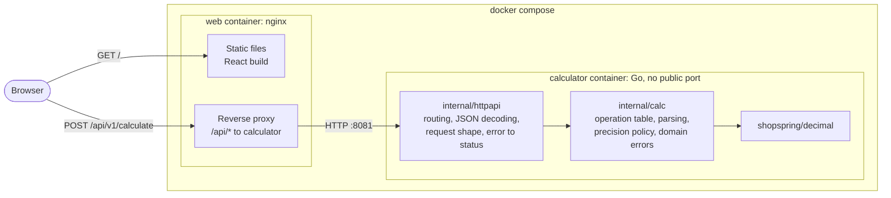
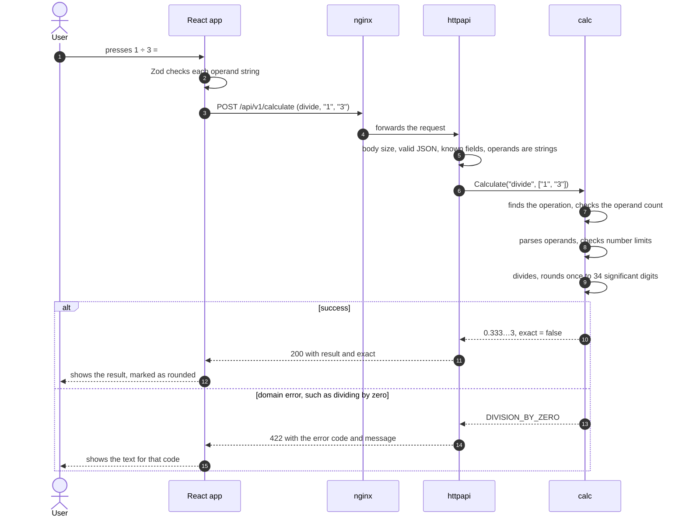
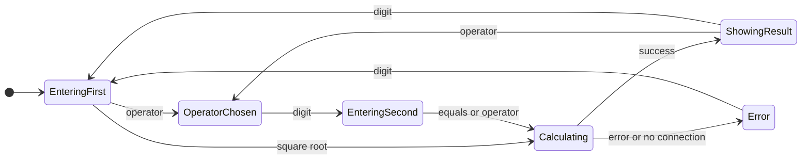
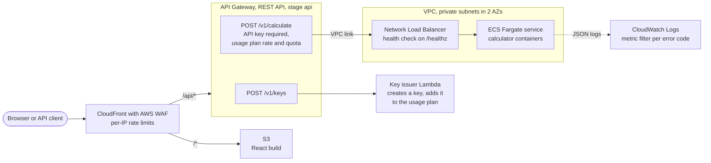
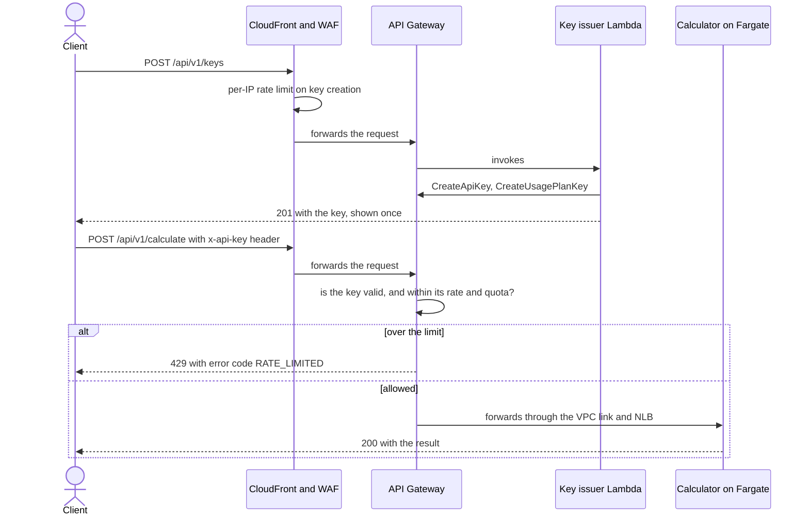

<!--
Draft written before any code exists. Before submitting:
- run every command below from a clean checkout and fix anything that differs
- confirm the Go and Node versions against go.mod and package.json
- add a screenshot with alt text, the CI badge, and the coverage numbers
- create PROMPTS.md
-->

# Calculator

A calculator web app with a Go backend that does exact decimal arithmetic. `0.1 + 0.2` returns `0.3`, and when a result has to be rounded, such as `1 ÷ 3`, the response says so.

The frontend is React and TypeScript in `frontend/`, and the backend is one Go service in `backend/`. It was built for a take-home assignment with a 2–4 hour brief, so it favours a small, well-tested core over extra features. An API gateway with API keys and rate limits, and the AWS deployment, are designed in [Production design](#production-design-not-built) but not built.

## Quick start

Requires Docker with Compose v2.

```sh
docker compose up --build
```

Open http://localhost:8080. To call the API directly:

```sh
curl -s http://localhost:8080/api/v1/calculate \
  -H 'Content-Type: application/json' \
  -d '{"operation": "add", "operands": ["0.1", "0.2"]}'
```

```json
{"result":"0.3","exact":true}
```

## What it does

| Operation    | Operands | Meaning                         | Example operands | Result                                   |
| ------------ | -------- | ------------------------------- | ---------------- | ---------------------------------------- |
| `add`        | 2        | a + b                           | `["0.1", "0.2"]` | `"0.3"`                                  |
| `subtract`   | 2        | a − b                           | `["5", "7.5"]`   | `"-2.5"`                                 |
| `multiply`   | 2        | a × b                           | `["1.5", "4"]`   | `"6"`                                    |
| `divide`     | 2        | a ÷ b                           | `["1", "3"]`     | `"0.3333333333333333333333333333333333"` |
| `power`      | 2        | a to the power b, b an integer  | `["2", "-2"]`    | `"0.25"`                                 |
| `sqrt`       | 1        | square root of a                | `["2"]`          | `"1.414213562373095048801688724209698"`  |
| `percentage` | 2        | a% of b, which is a × b ÷ 100   | `["15", "80"]`   | `"12"`                                   |

The frontend is a keypad, which also works from the keyboard. It runs one operation at a time, like a pocket calculator: each result becomes the first number of the next operation. The backend computes every result, and the browser does no arithmetic.

## API

### `POST /api/v1/calculate`

Request:

```json
{"operation": "divide", "operands": ["1", "3"]}
```

Success, `200`:

```json
{"result": "0.3333333333333333333333333333333333", "exact": false}
```

`exact` is `false` when the result was rounded to 34 significant digits, and `true` otherwise. Every response has an `X-Request-ID` header, and the same ID appears in the service's log line for that request.

#### Numbers

Operands and results are JSON strings, never JSON numbers. Browsers and most JSON libraries read JSON numbers as binary floating point, which would undo the exact arithmetic before it started.

A valid number:

- is a plain decimal: an optional `-`, then digits, then an optional fraction (`-12.5`, `0.001`, `42`). It has no `+`, no exponent (`1e5`), no spaces, and no leading or trailing dot (`.5`, `5.`).
- has at most 34 significant digits, counted from the first non-zero digit to the last.
- is zero, or has a magnitude of at least 10⁻¹⁰⁰ and less than 10¹⁰⁰.

Every result follows the same rules, so any result can be sent back as an operand.

#### Errors

Every error has the same shape:

```json
{"error": {"code": "DIVISION_BY_ZERO", "message": "Cannot divide by zero."}}
```

Clients should act on `code`. The `message` is meant for people reading logs or curl output, and its wording may change.

| Code                    | Status | When                                                                  |
| ----------------------- | ------ | --------------------------------------------------------------------- |
| `INVALID_REQUEST`       | 400    | The body is not valid JSON, has unknown fields, or lacks a field      |
| `INVALID_NUMBER`        | 400    | An operand is not a valid number string, or is a JSON number          |
| `WRONG_OPERAND_COUNT`   | 400    | For example, `sqrt` with two operands                                 |
| `UNSUPPORTED_OPERATION` | 400    | The operation is not in the table above                               |
| `NOT_FOUND`             | 404    | The path does not exist, such as `/api/v2/calculate`                  |
| `METHOD_NOT_ALLOWED`    | 405    | The wrong method for the path, such as `GET /api/v1/calculate`        |
| `INPUT_TOO_LARGE`       | 413    | The body is over 4 KiB, or an operand is over the number limits       |
| `DIVISION_BY_ZERO`      | 422    | Dividing by zero, or raising zero to a negative power                 |
| `NEGATIVE_SQUARE_ROOT`  | 422    | The square root of a negative number                                  |
| `INVALID_EXPONENT`      | 422    | A `power` exponent that is not an integer, or is outside −1000 to 1000 |
| `OUT_OF_RANGE`          | 422    | A result outside the number limits                                    |
| `INTERNAL_ERROR`        | 500    | A bug. The service logs it with the request ID                        |
| `SERVICE_UNAVAILABLE`   | 503    | Sent by nginx when the calculator is down or does not answer in time  |

#### More examples

Division by zero:

```sh
curl -s -i http://localhost:8080/api/v1/calculate \
  -H 'Content-Type: application/json' \
  -d '{"operation": "divide", "operands": ["10", "0"]}'
```

```
HTTP/1.1 422 Unprocessable Entity
Content-Type: application/json
X-Request-ID: 3f0c9a6e2b7d4c1e

{"error":{"code":"DIVISION_BY_ZERO","message":"Cannot divide by zero."}}
```

A JSON number where a string is expected:

```sh
curl -s http://localhost:8080/api/v1/calculate \
  -H 'Content-Type: application/json' \
  -d '{"operation": "add", "operands": [0.1, 0.2]}'
```

```json
{"error":{"code":"INVALID_NUMBER","message":"Operands must be strings, for example \"0.1\"."}}
```

### `GET /healthz`

Returns `200 {"status":"ok"}` while the process is running. The web container does not forward it. Compose checks it from inside the calculator container, and you can call it directly when the backend runs on its own (see below).

## Running without Docker

Backend, which requires Go 1.27 or newer:

```sh
cd backend
go run ./cmd/calculator          # listens on :8081; set PORT to change it
curl -s http://localhost:8081/healthz
```

Frontend, which requires Node.js 22 or newer:

```sh
cd frontend
npm ci
npm run dev                      # http://localhost:5173; forwards /api to localhost:8081
```

## Tests and coverage

```sh
cd backend
go test -race -coverprofile=coverage.out ./...
go tool cover -func=coverage.out          # summary; -html=coverage.out for the full report
```

```sh
cd frontend
npm test                                   # Vitest
npm run coverage                           # report in frontend/coverage/index.html
```

GitHub Actions runs both suites on every push and pull request, and uploads both coverage reports as build artifacts. It then starts the Compose stack and runs a smoke test: one calculation end to end, then a request with the calculator stopped, which must return the JSON `SERVICE_UNAVAILABLE` error.

What the tests cover:

- `internal/calc`: table-driven tests for every operation and every error code, rounding ties, the 34-digit boundary and the number limits. A separate test fails if the package uses a float type or a shopspring function that rounds on its own.
- `internal/httpapi`: `httptest` tests for each status and error code, unknown fields, JSON numbers, oversized bodies, and the request ID header.
- `cmd/calculator`: the server starts, and on shutdown it finishes a request that is still in flight.
- Frontend: the reducer, the Zod schemas run against the shared number cases, the API client with a stubbed `fetch`, and component tests with React Testing Library.

## Architecture

### System



The browser talks only to nginx, which serves the React build and forwards `/api/*` to the calculator, so the page and the API share one origin. The calculator has no port published to the host. Inside it, `httpapi` handles HTTP and never imports the decimal library. `calc` owns everything about numbers.

### Request flow



### Frontend state



Three rules sit outside the diagram. Digits, the decimal point and the sign key keep you in the current entry state. Clear returns to `EnteringFirst` from any state, and cancels a request that is still in flight. While in `Calculating`, every other key is ignored. When the request was started by an operator rather than `=`, the result becomes the first number and that operator is already chosen. The reducer that implements all of this is a pure function, so it is tested without rendering anything.

### Project layout

```
.
├── backend/
│   ├── cmd/calculator/      config, server start, graceful shutdown
│   ├── internal/httpapi/    routing, JSON decoding, request checks, error mapping, middleware
│   ├── internal/calc/       operation table, number parsing, precision policy, domain errors
│   └── Dockerfile
├── frontend/
│   ├── src/
│   ├── nginx.conf           serves the build, forwards /api/*, answers its own errors in JSON
│   └── Dockerfile           builds the app and runs it with nginx
├── testdata/numbers.json    accepted and rejected number strings, shared by both test suites
├── docker-compose.yml
├── .github/workflows/ci.yml
├── CLAUDE.md                ground rules followed while building this
├── PROMPTS.md
└── README.md
```

## Design decisions

### Numbers are strings from end to end

Binary floating point cannot represent 0.1 exactly, so `0.1 + 0.2` in `float64` gives `0.30000000000000004`. Decimal arithmetic in Go is not enough on its own, because JSON numbers get turned back into floats on the way in or out: by `JSON.parse` in the browser, and by Go's decoder if a field is a `float64`. So operands and results are strings everywhere, the frontend does no arithmetic, and a test fails if the `calc` package uses a float type.

### Decimal arithmetic with an explicit precision policy

The backend uses [shopspring/decimal](https://github.com/shopspring/decimal) because its API is immutable: every operation returns a new value, so a result cannot be overwritten by accident. Its defaults do not meet the rules here, though. `Div` rounds to 16 decimal places, so `0.000000000000000001 ÷ 3` returns `0` with no error, and `Sqrt(1e-40)` also returns `0`.

So `internal/calc` owns all rounding:

- Precision is 34 significant digits, the precision of the IEEE 754 decimal128 format. Digits are counted from the first non-zero digit, so a very small result keeps all of its digits.
- Rounding is half-even, which avoids the upward bias of always rounding halves up.
- Each result is rounded once. Add, subtract and multiply are exact in shopspring, so the policy rounds their exact result. Division uses `QuoRem` and sets the last digit from the exact remainder, so it never rounds twice.
- `exact: false` tells the client that rounding changed the result.
- In `calc`, shopspring functions that round by themselves (`Div`, `DivRound`, `Round`, `Sqrt`, `Pow`) and the `Require*` constructors, which panic on bad input, are banned. A test enforces this.

The alternative was [cockroachdb/apd](https://github.com/cockroachdb/apd), which provides a precision context and an `Inexact` flag out of the box, but writes results into mutable pointers. With shopspring, the precision policy is our own code, and it is tested as such.

### Why not integer minor units

Payment systems often store money as integers in a currency's smallest unit, such as cents. That works because the currency fixes the scale. A calculator has no currency and no fixed scale, and `√2` has no smallest unit. Arbitrary-precision decimals with one explicit rounding step do the same job here.

### One service, one endpoint

The brief asks for a backend microservice, so there is one. Splitting the operations into separate services would add network hops and deployment work while separating nothing that changes independently. Every operation goes through `POST /api/v1/calculate`. Each operation is a row in a table (name, operand count, function), so adding one means adding a row and its tests, with no handler changes.

### nginx serves the frontend and keeps one origin

The React build is a set of static files, and something has to serve them in production. nginx does that, and also forwards `/api/*` to the calculator, so the page and the API share one origin. This means there is no CORS configuration in Go, the frontend calls relative `/api/...` paths (Vite's dev server forwards them the same way during development), and the calculator has no public port. nginx is not an API gateway: it does no authentication or rate limiting. In production, that job belongs to AWS API Gateway (see [Production design](#production-design-not-built)).

Because nginx forwards API traffic, its own error responses reach API clients too. By default those are HTML pages, so nginx is configured to answer in the same JSON format: `SERVICE_UNAVAILABLE` (503) when the calculator is down or does not answer in time, and `INPUT_TOO_LARGE` (413) for a body over nginx's own 1 MB limit. CI checks this by stopping the calculator and expecting the JSON 503.

### Validation in three places, each with one job

| Layer          | Checks                                                                                        | Why                                              |
| -------------- | --------------------------------------------------------------------------------------------- | ------------------------------------------------ |
| Zod (frontend) | Each operand string matches the number format                                                 | Instant feedback. The backend never relies on it |
| `httpapi`      | Body size, valid JSON, no unknown fields, `operation` is a string, `operands` is a string array | Rejects malformed requests before any maths runs |
| `calc`         | Known operation, operand count, number format and limits, maths rules                         | One place owns everything about numbers          |

The number format is defined once: `testdata/numbers.json` lists accepted and rejected strings, and both the Go tests and Vitest run against it, so the two sides cannot drift apart.

### Errors are codes with fixed statuses

Every failure has a code from a fixed list, and each code maps to exactly one HTTP status. Clients act on the code, and the frontend chooses its own wording for each one. Domain errors such as division by zero are logged at info level, with the code as a field. A user dividing by zero is the service working correctly, and logging it as an error would page someone for nothing. Panics are recovered, logged at error level with the request ID, and returned as `INTERNAL_ERROR`.

### Dependencies

The backend uses the standard library (`net/http` routing patterns, `log/slog`, `testing`, `httptest`) plus shopspring/decimal. The frontend uses React, TypeScript, Vite, Base UI, Tailwind CSS, Zod, Vitest and React Testing Library, and calls the API with plain `fetch`. Any further dependency needs a reason written here.

### Shutdown and health

On SIGTERM, the server stops accepting connections and lets in-flight requests finish, with a 5-second limit that stays under Docker's 10-second stop grace period. The Dockerfile starts the binary with an exec-form `ENTRYPOINT`, so the Go process is PID 1 and receives the signal itself. With a shell-form `CMD`, the shell would be PID 1 and would not pass the signal on. The image has no shell or `curl`, so Compose's health check runs `calculator -healthcheck`, which calls `/healthz` and exits 0 or 1. There is no separate readiness endpoint, because nothing in this setup routes traffic based on one.

### Frontend

- The backend is the only place maths happens. The cost is a network round trip for every `=` and every chained operator. To handle that, the UI has a `Calculating` state, ignores keys while a request is in flight (Clear cancels it), and shows a separate message when the service cannot be reached: either a `SERVICE_UNAVAILABLE` response, or no response at all.
- State lives in the calculator component as a `useReducer`. There is one screen and nothing shared between components, so Redux would have nothing to do.
- Zod validates API responses as well as user input, turning each reply into a typed success-or-error value.
- [Base UI](https://base-ui.com) provides unstyled, accessible components, and Tailwind CSS styles them.

## Production design (not built)

The local build has no API gateway, authentication or rate limiting. This is how the service would run on AWS with all three. The same calculator image runs unchanged.





| Local build                         | AWS design                                                  |
| ----------------------------------- | ----------------------------------------------------------- |
| nginx serving the React build       | S3 behind CloudFront                                        |
| nginx forwarding `/api/*`           | A CloudFront behaviour forwarding `/api/*` to API Gateway   |
| No gateway, auth or rate limits     | WAF per-IP limits, plus API keys with usage plans           |
| The calculator container            | The same image on ECS Fargate, two or more tasks across AZs |
| Compose health check on `/healthz`  | NLB target health check on `/healthz`                       |
| `docker stop`: SIGTERM, 10 s grace  | ECS task stop: SIGTERM, 30 s default stop timeout           |
| JSON logs on stdout                 | CloudWatch Logs, with a metric filter per error code        |

- API keys identify a client so that API Gateway can throttle and meter it. They do not authenticate anyone, and AWS's documentation advises against using them for that. Real user sign-in would be a Cognito user pool authorizer.
- Anyone can create a key. Without a per-IP limit on key creation, a client that hits its usage-plan limit could simply create a new key, which is why the WAF rule sits in front.
- API Gateway caps the number of API keys per account and region (10,000 by default). Beyond that, keys would move to DynamoDB with a Lambda authorizer.
- Errors keep the same JSON shape in production. API Gateway's default error bodies look like `{"message": "Forbidden"}`, so its gateway responses are customised: throttling and quota errors become `RATE_LIMITED` (429), a missing or unknown key becomes `INVALID_API_KEY` (403), and integration failures or timeouts become `SERVICE_UNAVAILABLE` (503), the same code nginx sends locally. The WAF rate rule's block response uses the same `RATE_LIMITED` body.
- Fargate was chosen over Lambda because the same container image runs locally and in production, and the graceful shutdown and health check carry over unchanged. Lambda would need an adapter and would add cold starts to request latency.

## Assumptions and non-goals

- One operation at a time, evaluated left to right. There are no expressions and no operator precedence: `2 + 3 × 4` gives `20`, as on a pocket calculator.
- `power` takes integer exponents from −1000 to 1000. `0` to the power `0` is `1`. Fractional exponents give irrational results and would need their own rounding path, so they are left out.
- `percentage` means "a% of b".
- There are no complex numbers, so the square root of a negative number is an error.
- The local build has no API keys, rate limiting or authentication. See [Production design](#production-design-not-built).
- There is no history and no storage. The service is stateless.
- This is not a money library: it has no currencies, minor units or allocation rules.

## Prompts

The prompts used to design and build this are in [PROMPTS.md](PROMPTS.md), as the brief asks.
