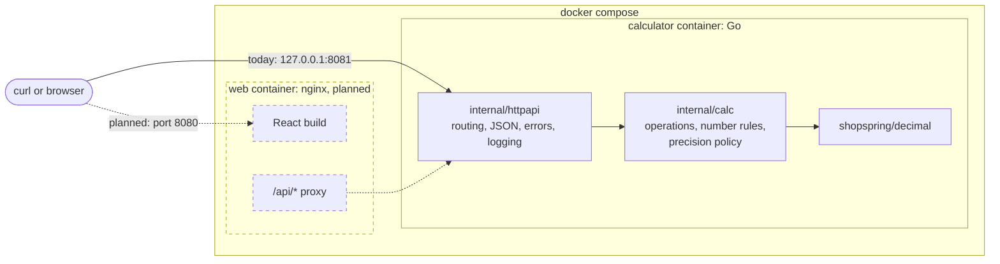

<!--
Before submitting:
- run every command below from a clean checkout and fix anything that differs
- re-measure coverage and update the table in "Tests and coverage"
- add a screenshot with alt text and the CI badge once they exist
- remove the temporary 127.0.0.1:8081 port mapping from docker-compose.yml once the web container exists
-->

# Calculator

A calculator with a Go backend that does exact decimal arithmetic. `0.1 + 0.2` returns `0.3`, and when a result has to be rounded, such as `1 ÷ 3`, the response says so.

**Status:** the Go backend is built and tested. Not built yet: the React frontend and the nginx container that will serve it ([design](docs/frontend-design.md)), CI, and the `power`, `sqrt` and `percentage` operations. The brief for this take-home allows 2–4 hours, so it favours a small, well-tested core over extra features.

## Quick start

Requires Docker with Compose v2.

```sh
docker compose up -d --build
curl -s http://127.0.0.1:8081/api/v1/calculate \
  -H 'Content-Type: application/json' \
  -d '{"operation": "add", "operands": ["0.1", "0.2"]}'
```

```json
{"result":"0.3","exact":true}
```

Until the frontend exists, the backend is published on `127.0.0.1:8081`. After that, nginx will serve the app on port 8080 and be the only way in.

## Operations

| Operation  | Operands         | Result                                                    |
| ---------- | ---------------- | --------------------------------------------------------- |
| `add`      | `["0.1", "0.2"]` | `"0.3"`                                                   |
| `subtract` | `["5", "7.5"]`   | `"-2.5"`                                                  |
| `multiply` | `["1.5", "4"]`   | `"6"`                                                     |
| `divide`   | `["1", "3"]`     | `"0.3333333333333333333333333333333333"`, `exact: false` |

Planned: `power` with integer exponents, `sqrt`, and `percentage` meaning "a% of b".

## API

### `POST /api/v1/calculate`

```json
{"operation": "divide", "operands": ["1", "3"]}
```

Success, `200`:

```json
{"result": "0.3333333333333333333333333333333333", "exact": false}
```

`exact` is `false` when the result was rounded to 34 significant digits. Every response has an `X-Request-ID` header, and the same ID appears in the service's log line for that request.

**Numbers** are JSON strings in both directions, never JSON numbers, because most clients would already have turned a JSON number into binary floating point. A valid number:

- is a plain decimal such as `-12.5`, `0.001` or `42`, with no `+`, no exponent and no bare `.`
- is at most 256 characters long
- has at most 34 significant digits
- is zero, or has a magnitude from 10⁻¹⁰⁰ up to (not including) 10¹⁰⁰

Results follow the same rules, so any result can be sent back as an operand.

**Errors** all have one shape. Clients should act on `code`; `message` is for people and may change.

```json
{"error": {"code": "DIVISION_BY_ZERO", "message": "Cannot divide by zero."}}
```

| Status | Codes                                                                                               |
| ------ | --------------------------------------------------------------------------------------------------- |
| 400    | `INVALID_REQUEST` (malformed body), `INVALID_NUMBER`, `WRONG_OPERAND_COUNT`, `UNSUPPORTED_OPERATION` |
| 404    | `NOT_FOUND`                                                                                         |
| 405    | `METHOD_NOT_ALLOWED`                                                                                |
| 413    | `INPUT_TOO_LARGE`: a body over 4 KiB, or an operand over the length or digit limit                  |
| 422    | `DIVISION_BY_ZERO`, `OUT_OF_RANGE`                                                                  |
| 500    | `INTERNAL_ERROR`: a bug, logged with the request ID                                                 |

Examples:

```sh
curl -s -i http://127.0.0.1:8081/api/v1/calculate \
  -H 'Content-Type: application/json' \
  -d '{"operation": "divide", "operands": ["10", "0"]}'
```

```
HTTP/1.1 422 Unprocessable Entity
Content-Type: application/json
X-Request-ID: 3f0c9a6e2b7d4c1e

{"error":{"code":"DIVISION_BY_ZERO","message":"Cannot divide by zero."}}
```

```sh
curl -s http://127.0.0.1:8081/api/v1/calculate \
  -H 'Content-Type: application/json' \
  -d '{"operation": "add", "operands": [0.1, 0.2]}'
```

```json
{"error":{"code":"INVALID_NUMBER","message":"Operands must be strings, for example \"0.1\"."}}
```

### `GET /healthz`

Returns `200 {"status":"ok"}` while the process is running. It is not logged.

## Running without Docker

The backend requires Go 1.27.4 or newer, as set in `go.mod`:

```sh
cd backend
go run ./cmd/calculator          # listens on :8081; set PORT to change it
```

The frontend is not built yet.

## Tests and coverage

```sh
cd backend
go test -race -coverprofile=coverage.out ./...
go tool cover -func=coverage.out          # or -html=coverage.out for the full report
```

Measured at commit `c7e9ee2`:

| Package               | Coverage | Not covered                                  |
| --------------------- | -------- | -------------------------------------------- |
| `internal/calc`       | 100%     |                                              |
| `internal/httpapi`    | 100%     |                                              |
| `cmd/calculator`      | 84.8%    | `main()` itself, and the shutdown-timeout path |
| Total                 | 96.3%    |                                              |

- **`internal/calc`:** expected results come from Python's `decimal` module, an independent implementation of the same rounding rules. The cases include half-even ties and results that round past 10¹⁰⁰. A fuzz test checks that any input gives either a named error or a valid operand, and that exact results survive the inverse operation. One test runs the shared number cases in `testdata/numbers.json`. Another fails if the package uses floats or a shopspring function that rounds on its own.
- **`internal/httpapi`:** every status and error code is tested. Each error must produce exactly one info-level log line carrying the request ID the client received. Panic recovery is tested, and a separate test fails if the package imports the decimal library.
- **`cmd/calculator`:** a request still in flight when shutdown starts must complete, and the `-healthcheck` flag is tested.

CI is not set up yet.

## Architecture



Dashed parts are planned. The calculator is one Go binary. `httpapi` handles HTTP and never imports the decimal library, and `calc` owns everything about numbers.

```
backend/
  cmd/calculator/      entry point: config, server, graceful shutdown, -healthcheck
  internal/httpapi/    routing, JSON decoding, error mapping, request IDs, logging
  internal/calc/       operation table, number rules, precision policy
  Dockerfile
testdata/numbers.json  number cases shared by the Go tests and, later, the frontend's
docs/                  frontend and production designs, not built
docker-compose.yml
CLAUDE.md              ground rules followed while building this
PROMPTS.md
```

## Design decisions

### Exact decimal arithmetic

In binary floating point, `0.1 + 0.2` is `0.30000000000000004`. Doing decimal arithmetic in Go isn't enough on its own, because JSON numbers get turned back into floats by `JSON.parse` in the browser, and by Go if a field is a `float64`. So numbers are strings everywhere, and a test fails if the `calc` package uses a float type.

The arithmetic uses [shopspring/decimal](https://github.com/shopspring/decimal), because its values are immutable. Its own rounding doesn't fit, though: `Div` rounds to 16 decimal places, so `0.000000000000000001 ÷ 3` comes back as `0`. So `internal/calc` owns all rounding:

- Every result keeps 34 significant digits (the IEEE 754 decimal128 precision), rounded half to even.
- Each result is rounded exactly once. Add, subtract and multiply are exact, and their result is rounded afterwards. Division truncates with `QuoRem`, and the exact remainder decides the last digit.
- shopspring's own rounding functions are banned in that package, and a test enforces it.

[cockroachdb/apd](https://github.com/cockroachdb/apd) offers this rounding control directly, but writes results into mutable pointers. With shopspring, the precision rules are our own roughly 50 lines of code, tested against the Python reference. Integer minor units, the usual choice for money, don't fit either: a calculator has no currency and no fixed scale.

### One service, one endpoint

The brief asks for a backend microservice, so there is one. Every operation goes through `POST /api/v1/calculate`. Each operation is a row in a table that holds its name, operand count and function, so adding one means adding a row and its tests.

### Validation and errors

`httpapi` checks only the shape of a request: its size, valid JSON, no unknown fields, and string operands. `calc` checks everything about the numbers. Each error code always maps to the same HTTP status. Errors caused by the request are logged at info level with their code, because a user dividing by zero is the service working correctly. Only a 500 is logged at error level.

### Shutdown and health

On SIGTERM, the server stops accepting connections and lets in-flight requests finish within 5 seconds, which is under Docker's 10-second stop grace period. The Dockerfile uses an exec-form `ENTRYPOINT`, so the Go process is PID 1 and receives the signal itself. The runtime image is distroless and has no shell or `curl`, so the health check runs `calculator -healthcheck`.

### Dependencies

The backend uses the Go standard library plus shopspring/decimal.

## Assumptions and non-goals

- One operation at a time, with no expressions or operator precedence.
- No authentication, rate limiting or API gateway. An AWS design with them is in [docs/production-design.md](docs/production-design.md), not built.
- No history and no storage. The service is stateless.
- This is not a money library: it has no currencies, minor units or allocation rules.

## Prompts

The prompts used to design and build this are in [PROMPTS.md](PROMPTS.md), as the brief asks.
