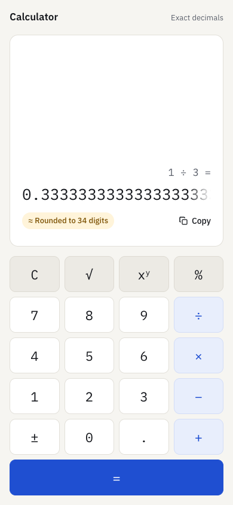
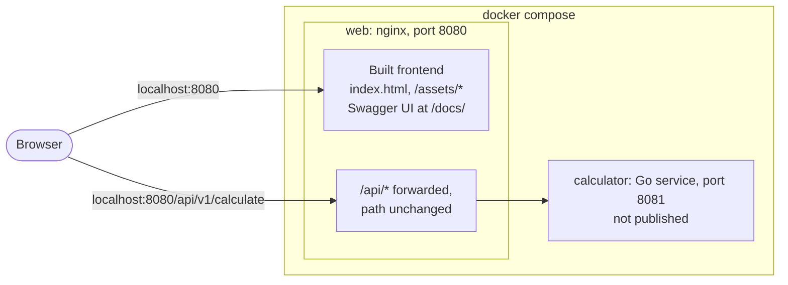

# Calculator

A React + TypeScript calculator backed by a Go service that does exact decimal arithmetic. `0.1 + 0.2` is `0.3`, and a result that had to be rounded, such as `1 ÷ 3`, is marked as rounded.



## Quick Start

Requires Docker with Compose v2.

```sh
docker compose up -d --build
```

- App: <http://localhost:8080>, with a short guide beside the calculator and links to the API docs
- API docs (Swagger UI): <http://localhost:8080/docs/>

```sh
curl -s http://localhost:8080/api/v1/calculate \
  -H 'Content-Type: application/json' \
  -d '{"operation": "add", "operands": ["0.1", "0.2"]}'
```

```json
{"result":"0.3","exact":true}
```

`docker compose down` stops it. Port 8080 taken? Copy `.env.example` to `.env` and set `WEB_PORT`.

## Local Development

Backend (Go 1.27.4+):

```sh
cd backend
go run ./cmd/calculator          # :8081, set PORT to change it
```

Frontend (Node.js 24 LTS; npm):

```sh
cd frontend
npm ci
npm run dev                      # http://localhost:5173, forwards /api to :8081
```

Settings live in one file: copy `.env.example` at the repository root to `.env` and edit it. It sets the published port (`WEB_PORT`) and where the dev server forwards `/api` (`API_PROXY_TARGET`). It is git-ignored and holds no secrets; the app itself always calls the relative `/api/v1/calculate`.

## Operations

| Operation    | Operands         | Result                                                   |
| ------------ | ---------------- | -------------------------------------------------------- |
| `add`        | `["0.1", "0.2"]` | `"0.3"`                                                  |
| `subtract`   | `["5", "7.5"]`   | `"-2.5"`                                                 |
| `multiply`   | `["1.5", "4"]`   | `"6"`                                                    |
| `divide`     | `["1", "3"]`     | `"0.3333333333333333333333333333333333"`, `exact: false` |
| `percentage` | `["12.5", "80"]` | `"10"` (12.5% of 80)                                     |
| `power`      | `["2", "-3"]`    | `"0.125"` (whole exponents from −1000 to 1000)           |
| `sqrt`       | `["2"]`          | `"1.414213562373095048801688724209698"`, `exact: false`  |

## API

`POST /api/v1/calculate` takes `{"operation": "...", "operands": ["...", ...]}` and returns `{"result": "...", "exact": true|false}`. Numbers are always JSON strings. The full description is in the Swagger UI at `/docs/`, from `GET /api/v1/openapi.json`.

A number is a plain decimal (`-12.5`, not `1e5` or `+3`), at most 256 bytes and 34 significant digits, and zero or between 10⁻¹⁰⁰ and 10¹⁰⁰.

Every error has the same shape:

```sh
curl -s http://localhost:8080/api/v1/calculate \
  -H 'Content-Type: application/json' \
  -d '{"operation": "divide", "operands": ["10", "0"]}'
```

```json
{"error":{"code":"DIVISION_BY_ZERO","message":"Cannot divide by zero."}}
```

| Status | Codes |
| ------ | ----- |
| 400    | `INVALID_REQUEST`, `INVALID_NUMBER`, `WRONG_OPERAND_COUNT`, `UNSUPPORTED_OPERATION` |
| 404    | `NOT_FOUND` |
| 405    | `METHOD_NOT_ALLOWED` |
| 413    | `INPUT_TOO_LARGE` |
| 422    | `DIVISION_BY_ZERO`, `NEGATIVE_SQUARE_ROOT`, `INVALID_EXPONENT`, `OUT_OF_RANGE` |
| 500    | `INTERNAL_ERROR` |
| 503    | `SERVICE_UNAVAILABLE` (from nginx, when the service is down) |

## Architecture



- **`backend/`**: one Go service. `internal/httpapi` handles HTTP and errors; `internal/calc` does the arithmetic and is pure.
- **`frontend/`**: React app. A pure `useReducer` state machine; the backend does every calculation.
- **`web`** container: nginx serves the app and forwards `/api/*`, so page and API share one origin (no CORS). It is the only published port.

## Design Decisions

- **One endpoint for all operations.** `POST /api/v1/calculate` names the operation in the body, so every operation shares one request shape, one validation path and one error format, and adding an operation is one row in a table rather than a new route.
- **Exact decimals.** [shopspring/decimal](https://github.com/shopspring/decimal) does the math; `calc` owns rounding: 34 significant digits, half to even, rounded once. `exact: false` says it rounded.
- **Numbers as strings.** JSON numbers become floats in browsers, so operands and results are strings and the API rejects JSON numbers. The frontend does no arithmetic, and a lint rule enforces it.
- **One error format, one status per code.** Defined in one table and checked by tests.
- **Validation on both sides.** The backend checks everything itself; the frontend checks the same rules (shared cases in `testdata/numbers.json`) only for instant feedback.
- **nginx in front, two containers.** The React build is static files and needs a server; nginx serves them and forwards `/api/*` to the Go service. Page and API share one origin, so there is no CORS and no backend URL in the frontend. The service has no published port, and when it is down nginx still answers in the JSON error format (`503 SERVICE_UNAVAILABLE`). nginx is not an API gateway: no auth or rate limiting (those are in the AWS design). Serving the build from Go would remove a container, but would tie frontend releases to the backend binary.
- **Stateless service.** Nothing is stored, so any instance can be replaced. It shuts down gracefully on SIGTERM.
- **Pocket-calculator input.** One operation at a time, left to right: `2 + 3 × 4` is `20`.

More detail: [docs/design.md](docs/design.md). How this would run on AWS (not built): [docs/production-design.md](docs/production-design.md).

## Testing and Coverage

```sh
(cd backend && go test -race -coverprofile=coverage.out ./... && go tool cover -func=coverage.out)
(cd frontend && npm ci && npm run lint && npm run typecheck && npm test -- --coverage)
```

| Layer                   | Coverage (statements) |
| ----------------------- | --------------------- |
| Backend (`calc`, `httpapi`) | 100%              |
| Backend total           | 97.3%                 |
| Frontend (283 tests)    | 99.6%                 |

Backend expected values come from Python's `decimal` module (`backend/internal/calc/testdata/reference.py`), and fuzz tests compare results with `math/big`. CI (`.github/workflows/ci.yml`) runs both suites, uploads both coverage reports, and runs a Compose smoke test (`scripts/smoke.sh`).

## Assumptions

- Results keep 34 significant digits; inputs over the limits are rejected, never rounded.
- Division by zero is an error, not infinity. `0^0` is `1`.
- `percentage(a, b)` is a% of b.
- No authentication, storage or history.

## AI Usage

Built with Claude Code; I read, reviewed and tested the code. Three files in the repository root show how the work was steered:

- **[CLAUDE.md](CLAUDE.md)**: the project's standing instructions, which Claude Code loads at the start of every session. It sets the scope, the architecture and ten ground rules, such as "no floats where numbers pass through" and "every failure is a named error with one status". Each rule has a test or lint check behind it, so a change that breaks one fails CI. Code comments such as "CLAUDE.md rule 5" point back to these rules.
- **[stories.md](stories.md)**: the build checklist, written before the code. It lists every deliverable in build order, with the brief's requirements marked, and an item was ticked only once it was built and verified.
- **[PROMPTS.md](PROMPTS.md)**: the prompts, with a short summary first.
