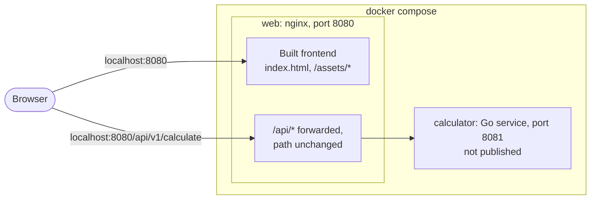
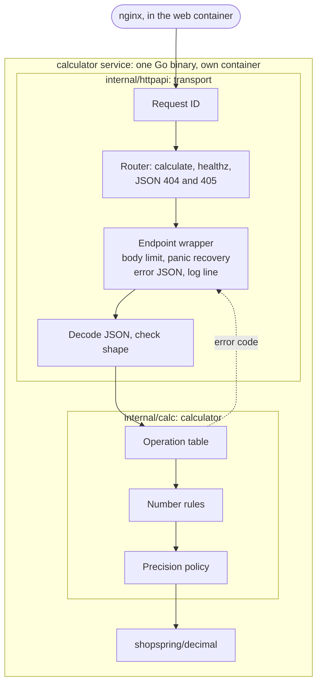
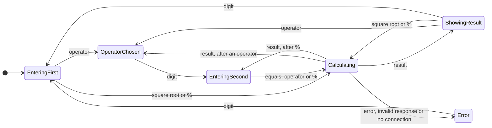

<!--
Before submitting:
- add an application screenshot with alt text once the frontend exists
- run every command below from a clean checkout and fix anything that differs
- re-measure coverage and update the table in "Testing and Coverage"
-->

# Calculator

A calculator with a Go backend that does exact decimal arithmetic. `0.1 + 0.2` returns `0.3`, and when a result has to be rounded, such as `1 ÷ 3`, the response says so.

The Go backend is built and tested, with all seven operations. So is the core of the React frontend: its number checks, its API client and the calculator's state machine. The web container is built too: nginx serves the frontend and forwards API calls to the backend. Not built yet: the frontend's interface (keypad, display and layout) and CI. The brief for this take-home allows 2–4 hours, so it favours a small, well-tested core over extra features.

<!-- Application screenshot goes here once the frontend exists. -->

## Quick Start

Requires Docker with Compose v2.

```sh
docker compose up -d --build
```

Then open <http://localhost:8080>. The same port serves the API:

```sh
curl -s http://localhost:8080/api/v1/calculate \
  -H 'Content-Type: application/json' \
  -d '{"operation": "add", "operands": ["0.1", "0.2"]}'
```

```json
{"result":"0.3","exact":true}
```

Port 8080 is published on `127.0.0.1` only, so the app is reachable from this machine and not from the network. The calculator service has no published port; nginx is the only way in. `docker compose down` stops both containers.

## Local Development

The backend requires Go 1.27.4 or newer, as set in `go.mod`:

```sh
cd backend
go run ./cmd/calculator          # listens on :8081; set PORT to change it
```

The frontend uses npm. Its test tools need Node.js `^22.22.2`, `^24.15.0` or `>=26.0.0` (jsdom's requirement; Vitest's is looser). It has been run on Node.js 25.2.1, which works but makes npm warn about the engine version.

```sh
cd frontend
npm ci
npm run dev                      # http://localhost:5173, forwards /api to the backend on :8081
```

The page is a placeholder until the interface is built. `npm run build` type-checks and writes the production build to `frontend/dist`.

## Supported Operations

| Operation    | Operands          | Result                                                    |
| ------------ | ----------------- | --------------------------------------------------------- |
| `add`        | `["0.1", "0.2"]`  | `"0.3"`                                                   |
| `subtract`   | `["5", "7.5"]`    | `"-2.5"`                                                  |
| `multiply`   | `["1.5", "4"]`    | `"6"`                                                     |
| `divide`     | `["1", "3"]`      | `"0.3333333333333333333333333333333333"`, `exact: false` |
| `percentage` | `["12.5", "80"]`  | `"10"` (12.5% of 80)                                      |
| `power`      | `["2", "-3"]`     | `"0.125"`                                                 |
| `sqrt`       | `["2"]`           | `"1.414213562373095048801688724209698"`, `exact: false`  |

- `percentage` is a% of b, which is a × b ÷ 100.
- `power` takes a whole-number exponent from −1000 to 1000. Anything else, such as `2.5` or `1001`, is `INVALID_EXPONENT`. The exponent is checked by value, so `"2.0"` and `"-0"` are accepted. `0^0` is `1`, and zero to a negative power is `DIVISION_BY_ZERO`.
- `sqrt` takes one operand. A negative operand is `NEGATIVE_SQUARE_ROOT`. The square root of `-0` is `0`.

## API

### `POST /api/v1/calculate`

```json
{"operation": "divide", "operands": ["1", "3"]}
```

Success, `200`:

```json
{"result": "0.3333333333333333333333333333333333", "exact": false}
```

`exact` is `false` when the result was rounded. Every response has an `X-Request-Id` header, and the same ID appears in nginx's access log line and the service's log line for that request. A request that sends its own `X-Request-ID` (1 to 64 letters, digits and hyphens) keeps it.

The body must be one JSON object with exactly two keys, `operation` and `operands`, each appearing once and matched case-sensitively. Operands and results are JSON strings. A valid number:

- is a plain decimal such as `-12.5`, `0.001` or `42`, with no `+`, no exponent and no bare `.`
- is at most 256 characters long
- has at most 34 significant digits
- is zero, or has a magnitude from 10⁻¹⁰⁰ up to (not including) 10¹⁰⁰

Every error has the same shape. Clients should act on `code`; `message` is for people and may change.

| Status | Codes                                                                                               |
| ------ | --------------------------------------------------------------------------------------------------- |
| 400    | `INVALID_REQUEST` (malformed body), `INVALID_NUMBER`, `WRONG_OPERAND_COUNT`, `UNSUPPORTED_OPERATION` |
| 404    | `NOT_FOUND`, also for a path that is not in clean form, such as `/api/v1//calculate`                |
| 405    | `METHOD_NOT_ALLOWED`, with an `Allow` header listing the methods the path accepts                   |
| 413    | `INPUT_TOO_LARGE`: a body over 4 KiB, or an operand over the length or digit limit. nginx sends it too, for a body over 16 KiB, which never reaches the service |
| 422    | `DIVISION_BY_ZERO`, `NEGATIVE_SQUARE_ROOT`, `INVALID_EXPONENT`, `OUT_OF_RANGE`                      |
| 500    | `INTERNAL_ERROR`: a bug, logged with the request ID                                                 |
| 503    | `SERVICE_UNAVAILABLE`: sent only by nginx, when the service is down or does not answer in time       |

```sh
curl -s -i http://localhost:8080/api/v1/calculate \
  -H 'Content-Type: application/json' \
  -d '{"operation": "divide", "operands": ["10", "0"]}'
```

Response (`Server`, `Date`, `Content-Length`, `Connection` and the security headers nginx adds left out):

```
HTTP/1.1 422 Unprocessable Entity
Content-Type: application/json
X-Request-Id: 3f0c9a6e2b7d4c1e

{"error":{"code":"DIVISION_BY_ZERO","message":"Cannot divide by zero."}}
```

```sh
curl -s http://localhost:8080/api/v1/calculate \
  -H 'Content-Type: application/json' \
  -d '{"operation": "add", "operands": [0.1, 0.2]}'
```

```json
{"error":{"code":"INVALID_NUMBER","message":"Operands must be strings, for example \"0.1\"."}}
```

`sqrt` takes a single operand:

```sh
curl -s http://localhost:8080/api/v1/calculate \
  -H 'Content-Type: application/json' \
  -d '{"operation": "sqrt", "operands": ["2"]}'
```

```json
{"result":"1.414213562373095048801688724209698","exact":false}
```

```sh
curl -s http://localhost:8080/api/v1/calculate \
  -H 'Content-Type: application/json' \
  -d '{"operation": "power", "operands": ["2", "0.5"]}'
```

```json
{"error":{"code":"INVALID_EXPONENT","message":"The exponent must be a whole number from -1000 to 1000."}}
```

### `GET /healthz`

Returns `200 {"status":"ok"}` while the process is running. It is not logged. The service's `/healthz` is for its own container's health check and is not published; `http://localhost:8080/healthz` is nginx's, which answers the same way without calling the service.

## Architecture

Docker Compose runs two containers:



- **`web`** (`frontend/Dockerfile`, `frontend/nginx.conf`) runs nginx. It serves the built React app and forwards every `/api/*` request to the calculator with its path unchanged. It is the only container with a published port. It starts once the calculator reports healthy.
- **`calculator`** (`backend/Dockerfile`) is the Go service. It is reachable only from inside the Compose network.

Inside the calculator service:



The service is one Go binary with two packages, and depends only on the standard library and shopspring/decimal.

- **`internal/httpapi`** is the transport. It routes, decodes JSON, checks the request's shape, maps error codes to statuses and writes the logs. Handlers return their error instead of writing it, so one wrapper produces every error response and log line. The package never imports the decimal library, and a test checks that.
- **`internal/calc`** is the calculator. It looks the operation up in a table, checks the operands against the number rules, runs the operation and applies the precision policy. It is pure: no I/O, no logging and no state.


## Design Decisions

### Decimal precision

The arithmetic uses [shopspring/decimal](https://github.com/shopspring/decimal), because its values are immutable. Its own rounding doesn't fit, though: `Div` rounds to 16 decimal places, so `0.000000000000000001 ÷ 3` comes back as `0`. So `internal/calc` owns all rounding:

- Every result keeps 34 significant digits (the IEEE 754 decimal128 precision), rounded half to even.
- Each result is rounded exactly once. Add, subtract, multiply and percentage are exact, and their result is rounded afterwards. Division truncates with `QuoRem`, and the exact remainder decides the last digit. Square root and power are described below.
- `calc` may use only an allowlist of 21 shopspring functions and methods, plus its `Decimal` type, and `Bit` and the integer `Sqrt` from `math/big`. That keeps out the ones that round or format on their own terms, such as `Div`, `Sqrt`, `Pow`, `Avg` and the `UseScientificNotation` setting. A test enforces it.

[cockroachdb/apd](https://github.com/cockroachdb/apd) offers this rounding control directly, but writes results into mutable pointers. With shopspring, the precision rules are our own roughly 100 lines of code. They are tested against Python's `decimal` module, and the fuzz tests compare every add, subtract, multiply, divide, percentage and power result with an exact `math/big` calculation that is rounded separately. Integer minor units, the usual choice for money, don't fit either: a calculator has no currency and no fixed scale.

### Square root and power

shopspring's `Sqrt` and `Pow` round to a fixed number of decimal places, like `Div`, so both have their own path in `precision.go`. Each keeps something exact to round from, so there is still only one rounding step.

- **Square root:** the operand is scaled by an even power of ten to a whole number N with 67 or 68 digits. Go's `big.Int.Sqrt` gives q = ⌊√N⌋ exactly, which is the root truncated to 34 digits. The exact remainder N − q² decides the last digit: round up when it is greater than q. A square root can never land exactly halfway, so there is no tie to break. `exact` is `true` only when the remainder is zero.
- **Power:** the base is raised to the exponent exactly, by repeated squaring. With at most 34 significant digits in the base and an exponent of at most 1000, the exact power has at most 34 000 digits, which takes under 2 ms even for the largest inputs. A positive power is then rounded once. A negative power is 1 divided by the exact power, through the same division as `divide`. A result outside the range is `OUT_OF_RANGE`, checked after rounding like every other operation.

### String-based numerical representation

In binary floating point, `0.1 + 0.2` is `0.30000000000000004`. Doing decimal arithmetic in Go isn't enough on its own, because JSON numbers get turned back into floats by `JSON.parse` in the browser, and by Go if a field is a `float64`. So numbers are strings everywhere:

- The API rejects JSON numbers.
- The frontend does no arithmetic. In the app's source (not its tests), ESLint bans the `Number`, `parseFloat`, `parseInt`, `Math` and `BigInt` globals and any member with those names (such as `globalThis.Number`), unary `+`, the operators `-`, `*`, `/`, `%` and `**` with their compound assignments, and `++` and `--`. Binary `+` is allowed because it also joins strings. Its number checks read the string itself.
- A test fails if `calc` uses a float type.

Every result follows the same rules as an operand, so a result can always be sent back. The accepted and rejected formats are listed once in `testdata/numbers.json`, and both the Go tests and the frontend's number schema tests run against it.

### Stateless backend

The brief asks for a backend microservice, so there is exactly one, and it stores nothing. Any instance can be stopped or replaced at any time.

On SIGTERM, the server stops accepting connections and lets in-flight requests finish within 5 seconds, which is under Docker's 10-second stop grace period. The Dockerfile uses an exec-form `ENTRYPOINT`, so the Go process is PID 1 and receives the signal itself. The runtime image is distroless and has no shell or `curl`, so the health check runs `calculator -healthcheck`.

### Validation and error handling

`httpapi` checks only the shape of a request. It reads the whole body before parsing, so any body over 4 KiB is `INPUT_TOO_LARGE` wherever its first syntax error is, and it parses with `encoding/json/v2`, which rejects duplicate keys and anything after the object. `calc` checks everything about the numbers, and an operation's operand count is part of its row in the operation table, so adding an operation touches one place. The frontend's `numberError` (`frontend/src/number.ts`) applies the same number rules in the same order as `parseOperand` in `number.go`, so each rejection has the code the backend would send, and it runs against `testdata/numbers.json` too. Its Zod schema, used on API results, is defined by it. It is there to stop the user typing an invalid number; the backend never relies on it.

One table maps each error code to its HTTP status. A test type-checks `calc` and fails if any constant of type `Code` is missing from the table. Errors caused by the request are logged at info level with their code, because a user dividing by zero is the service working correctly. Only a 500 is logged at error level, together with its cause.

### Serving through nginx

The browser talks to one origin, `localhost:8080`. nginx serves the built app there and forwards `/api/*` to the calculator, so the client calls a relative URL and the service needs no CORS headers and no published port. The Vite dev server does the same forwarding in development, so the client code is identical in both.

nginx here is a static file server and a reverse proxy, not an API gateway. It does no authentication, rate limiting, request rewriting or routing between services; the service validates every request itself. A gateway with API keys and rate limits is part of the [production design](docs/production-design.md), not built.

- **Errors in one format.** Every response a client sees uses the service's error JSON, including the ones nginx makes itself. nginx's 502 (no address for the service, or a refused connection), 504 (no connection or no answer in time) and 503 all become `503 SERVICE_UNAVAILABLE`, and its 413 becomes `INPUT_TOO_LARGE`, with `Content-Type: application/json`. nginx does not intercept the service's own responses, so the service's 400, 404, 405, 413, 422 and 500 bodies pass through untouched.
- **Body limit.** The service's 4 KiB limit is the one that applies. nginx's limit is 16 KiB, a backstop that stops a large body before it is forwarded. A 10 KB body therefore gets the service's `INPUT_TOO_LARGE`, and a 20 KB body gets nginx's.
- **Finding the service.** nginx looks the calculator's address up through Docker's DNS at run time (every 5 seconds) instead of once at start, so it starts before the calculator is resolvable and finds a restarted container with a new address. After a restart, requests succeed again within about 5 seconds.
- **Request IDs.** nginx forwards a well-formed incoming `X-Request-ID` (the same pattern the service accepts), or makes one, and logs it. The service keeps it, so one ID ties the two log lines together.
- **Caching.** Files under `/assets/` have content hashes in their names, so they are cached for a year (`immutable`). `index.html` is `no-cache`, so a new build is picked up on the next load. A missing asset is a 404, never `index.html`; every other path falls back to `index.html` for the single-page app.
- **Security headers.** `X-Content-Type-Options: nosniff`, `Referrer-Policy: no-referrer`, `X-Frame-Options: DENY` and a Content Security Policy: scripts and API calls from this origin only, fonts from Google Fonts (`fonts.googleapis.com` for the stylesheet, `fonts.gstatic.com` for the files). Styles also allow `'unsafe-inline'`, because Base UI's scroll area adds a small `<style>` element to hide its native scrollbar, and a nonce would need nginx to template the page. `server_tokens off` hides the nginx version.
- **Build context.** The image is built from the repository root, not `frontend/`, because `npm run build` type-checks the tests too, and one of them imports `testdata/numbers.json`. Building with `vite build` alone would skip the type check, so the image could be built from code that fails it. The root `.dockerignore` is an allowlist: only `frontend/` (without `node_modules`, `dist` and `coverage`) and that one JSON file are sent.
- **Container.** The runtime image is `nginxinc/nginx-unprivileged`: it runs as a non-root user on port 8080. The container is read-only with a tmpfs on `/tmp` for nginx's pid and temp files, drops every capability and sets `no-new-privileges`, like the calculator's. nginx is started directly in exec form as PID 1, skipping the base image's entrypoint scripts, which would try to rewrite the config on a read-only filesystem. It stops on `SIGQUIT`, nginx's graceful shutdown, which finishes in-flight requests.
- **Port binding.** Port 8080 is published on `127.0.0.1` only. The app is for the person running it, so nothing is exposed to the local network; change the mapping to `"8080:8080"` to open it.

### Frontend state management

The calculator's state is a `useReducer` with a pure reducer (`frontend/src/calculator.ts`), tested without rendering. There is one screen and nothing shared between components, so there is no Redux. The interface that will press its keys is not built yet.



- **The shown number.** Each number on the display is a `Shown` value: either typed, or a result from the backend with its `exact` flag. One function, `applyEntryKey`, applies the digit, decimal point and sign keys to it.
  - On a typed number, the keys edit it and keep you in the current entry state. A key that would make an invalid operand, such as a second decimal point, a 35th significant digit or a 257th character, is ignored. The check is `numberError`, and a number ending in `.` is allowed only if a digit could still follow it. The sign key on `0` gives `-0`, so a negative number can be typed sign first.
  - On a result, a digit or the decimal point starts a new typed number from `0`. The sign key negates the result by toggling its minus sign and keeps its `exact` flag. A zero result has no sign and stays as it is.
  - After an operator or an error, the keys start a new typed number from `0`, so `.` gives `0.` and the sign key gives `-0`.
- **Clear** returns to `EnteringFirst` from any state. In `Calculating`, every other key is ignored.
- **Chaining.** When an operator started the request, the result becomes the first number with that operator chosen, so `2 + 3 × 4 =` sends `add(2, 3)` and then `multiply(5, 4)`. A second operator key in a row replaces the first.
- **The `%` key.** After `a + b`, `%` sends `percentage(b, a)` and the result replaces `b`, so `50 + 10 % =` gives `55`. Like any result, it is replaced by the next digit: `50 + 10 % 3 =` sends `add(50, 3)`. With no operator chosen, `x %` sends `percentage(x, 1)`, which is x ÷ 100. Right after an operator, `%` is ignored.
- **Rounded results.** A result keeps its `exact` flag wherever it goes: `ShowingResult`, the first number after an operator, or the second number after `%`. So the display can mark it.

The reducer does no arithmetic and no fetching. Entering `Calculating` is the request: the state holds the request to send, where its result goes (`ShowingResult`, `OperatorChosen` with the next operator, or back into the second number), and the number that was on the display. `useCalculator` runs one effect per request object, sends it, and dispatches `settled` with that request and its outcome. The reducer settles only when it is the same request object it is waiting for, so a late answer to a cleared request is ignored. Leaving `Calculating` (Clear) or unmounting also aborts the fetch through its `AbortController`. The hook returns `{ state, press }`; `press` takes keypad keys only, never `settled`.

### Frontend API client

`frontend/src/api.ts` calls `POST /api/v1/calculate` with native `fetch` and a relative URL, because nginx serves the page and the API from one origin. In development, Vite forwards `/api` to the backend on port 8081. Zod checks every response, and a result must itself be a valid operand. `calculate()` never throws; it returns one of:

- `success`, with `result` and `exact`
- `error`, with the API's error code and its message. The code is `null` when this client doesn't know it, for example a code added to a newer backend; the message is still shown.
- `invalidResponse`: a JSON answer that breaks the API's contract, such as a 200 whose result is a JSON number or not a valid operand, an error body with a 200 status, a success body with an error status, or an error without a message
- `unreachable`: no response, or a body that is not JSON, such as a proxy's HTML error page. An aborted request also ends here, and the reducer ignores it.

### Frontend dependencies

Versions are pinned exactly in `frontend/package.json`, with a committed lockfile.

| Package | Why |
| ------- | --- |
| `react`, `react-dom` | The UI library the brief asks for. |
| `zod` | Validates typed input and API responses with one schema per shape, instead of hand-written type guards. |
| `@base-ui/react` | Unstyled, accessible components for the keypad. Installed with the scaffold; the placeholder page does not use it yet. |
| `vite`, `@vitejs/plugin-react` | Dev server with the `/api` proxy, and the production build. |
| `typescript` | Strict type checking. Version 6.0, because `typescript-eslint` does not support TypeScript 7 yet. |
| `tailwindcss`, `@tailwindcss/vite` | Styling with utility classes, built by the Vite plugin with no separate config file. |
| `vitest`, `@vitest/coverage-v8` | Test runner that shares Vite's config, and its coverage report. |
| `jsdom` | A browser environment for tests that render or use React hooks. |
| `@testing-library/react`, `@testing-library/dom` | Renders components and hooks in tests; the second is the first's required peer. |
| `eslint`, `@eslint/js`, `typescript-eslint`, `eslint-plugin-react-hooks` | Linting, type-aware for TypeScript, with the rules of hooks and the ban on arithmetic. |
| `@types/react`, `@types/react-dom`, `@types/node` | Type definitions for React, and for Node in `vite.config.ts`. |

## Testing and Coverage

```sh
cd backend
go test -race -coverprofile=coverage.out ./...
go tool cover -func=coverage.out          # or -html=coverage.out for the full report
```

Last measured on 2026-11-26:

| Package            | Coverage | Not covered |
| ------------------ | -------- | ----------- |
| `internal/calc`    | 100%     |             |
| `internal/httpapi` | 100%     |             |
| `cmd/calculator`   | 84.8%    | `main()` itself; the error returns for a bad flag, a failed shutdown and a malformed health-check URL; the `PORT` default |
| Total              | 97.3%    |             |

- **`internal/calc`:** expected results come from Python's `decimal` module, an independent implementation of the same rounding rules. For power, Python computes the exact power and rounds it once. `backend/internal/calc/testdata/reference.py` (standard library only) recomputes every row of the two result tables; run `python3 testdata/reference.py` in `backend/internal/calc`, and it exits non-zero if any expected value, `exact` flag or error code differs. The cases include half-even ties, results that round past 10¹⁰⁰ or land exactly on 10⁻¹⁰⁰, exponents of ±1000 and 1001, `2.5`, `-0` and `1.0`, and square roots of exact squares, tiny and huge numbers and zero. A fuzz test checks that any add, subtract, multiply, divide or percentage gives either a named error or a valid operand, that every result and its `exact` flag match an exact `math/big` calculation rounded separately, and that exact results of the first four survive the inverse operation. Two more fuzz tests cover power and square root. Every power, its `exact` flag and every refusal must match the same `math/big` reference, which raises numerator and denominator separately. An exact power of −1 taken again gives the base back, and the square root of an exact square gives the base's absolute value. An exact root squared gives the operand back, and a rounded root r is within half a unit in its last place, checked exactly by squaring r minus and plus that half unit. One test runs the shared number cases. Another type-checks the package and fails on any of these:
  - a value of float type
  - a function or method from another package outside the allowlist, which keeps out shopspring's self-rounding calls and anything that changes a value in place
  - an import that could do I/O, read the clock or log
  - a package-level variable other than the operation table and the number pattern
  - a direct write to a package-level variable: an assignment, `++` or `--`, `delete`, `clear`, or taking its address (a write through a copied map reference is not caught)

  That check is itself tested against a sample that breaks each rule.
- **`internal/httpapi`:** every status and error code is tested, including the exact 4 KiB body limit, duplicate keys, oversized bodies that are not JSON, paths not in clean form, and a 405 on every route. Each error must produce exactly one info-level log line carrying the request ID the client received. Panics and unmapped codes must become a 500 whose log line keeps the original error. One test fails if a `calc` error code, found by type-checking the package, has no HTTP status. Another fails if the package imports the decimal library.
- **`cmd/calculator`:** a request still in flight when shutdown starts must complete, and the `-healthcheck` flag is tested.

The frontend:

```sh
cd frontend
npm ci
npm run lint
npm run typecheck
npm test -- --coverage           # HTML report in frontend/coverage/index.html
```

Last measured on 2026-11-26: 100% of statements, branches, functions and lines in `number.ts`, `api.ts`, `calculator.ts`, `useCalculator.ts` and the placeholder `App.tsx`. `main.tsx`, which only mounts the app, is excluded.

- **`number.ts`:** every case in `testdata/numbers.json` must be accepted, or rejected by `numberError` with the code the file gives. Length is measured in UTF-8 bytes, as Go does.
- **`api.ts`:** `fetch` is mocked. Tests cover the request sent, success, a known error, an error code it does not know (kept as an error with its message), each kind of contract-breaking answer, a body that is not JSON, and a network failure.
- **`calculator.ts`:** one test per arrow in the state diagram, plus Clear from every state, every key ignored in `Calculating`, an answer to an old or different request ignored, each `%` case, the entry keys on typed numbers and on results, and the entry limits.
- **`useCalculator.ts`:** `fetch` is mocked. Tests check that one request is sent per calculation, that Clear and unmount abort it, and that the answer to a cleared request cannot settle the next one.

CI is not set up yet.

## Assumptions

- **Precision and rounding:** every result keeps 34 significant digits, rounded half to even, and `exact: false` marks a rounded result. Inputs over the number limits are rejected, never rounded.
- **Operations:** one operation per request. The frontend's state machine chains them left to right like a pocket calculator, so `2 + 3 × 4` gives `20`, with no operator precedence. Division by zero is an error, not infinity.
- **Power, square root and percentage:** `0^0` is `1`, the convention most programming languages use. The exponent is limited to whole numbers from −1000 to 1000: a fractional exponent usually gives an irrational result, with no exact value to round once from, and the limit keeps the exact power to at most 34 000 digits. `percentage` means "a% of b", so `percentage(50, 200)` is `100`.
- **Scope:** there is no authentication, rate limiting or API gateway. An AWS design with them is in [docs/production-design.md](docs/production-design.md), not built. There is no history or storage. This is not a money library: it has no currencies, minor units or allocation rules.

## AI Usage

This was built with Claude Code. The prompts used to design and build it are in [PROMPTS.md](PROMPTS.md), as the brief asks.
