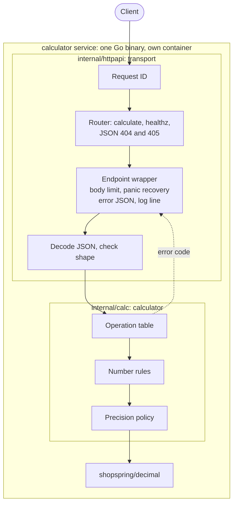
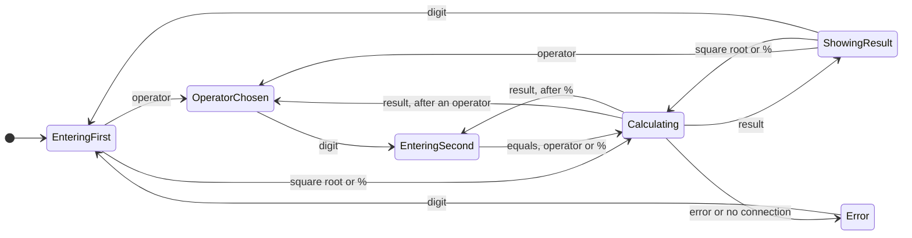

<!--
Before submitting:
- add an application screenshot with alt text once the frontend exists
- run every command below from a clean checkout and fix anything that differs
- re-measure coverage and update the table in "Testing and Coverage"
- remove the temporary 127.0.0.1:8081 port mapping from docker-compose.yml once the web container exists
-->

# Calculator

A calculator with a Go backend that does exact decimal arithmetic. `0.1 + 0.2` returns `0.3`, and when a result has to be rounded, such as `1 ÷ 3`, the response says so.

The Go backend is built and tested. So is the core of the React frontend: its number checks, its API client and the calculator's state machine. Not built yet: the frontend's interface (keypad, display and layout), the nginx container that will serve it ([design](docs/frontend-design.md)), CI, and the `power`, `sqrt` and `percentage` operations in the backend. The brief for this take-home allows 2–4 hours, so it favours a small, well-tested core over extra features.

<!-- Application screenshot goes here once the frontend exists. -->

## Quick Start

Requires Docker with Compose v2.

```sh
docker compose up -d --build
curl -s http://127.0.0.1:8081/api/v1/calculate \
  -H 'Content-Type: application/json' \
  -d '{"operation": "add", "operands": ["0.1", "0.2"]}'
```

```json
{"result":"0.3","exact":true}
```

Until the frontend exists, the backend is published on `127.0.0.1:8081`. After that, nginx will serve the app on port 8080 and be the only way in.

## Local Development

The backend requires Go 1.27.4 or newer, as set in `go.mod`:

```sh
cd backend
go run ./cmd/calculator          # listens on :8081; set PORT to change it
```

The frontend uses npm. Its test tools (jsdom, Vitest) support Node.js 22.22+, 24.15+ or 26+; it has been run on Node.js 25.2.1, which works but makes npm warn about the engine version.

```sh
cd frontend
npm ci
npm run dev                      # http://localhost:5173, forwards /api to the backend on :8081
```

The page is a placeholder until the interface is built. `npm run build` type-checks and writes the production build to `frontend/dist`.

## Supported Operations

| Operation  | Operands         | Result                                                    |
| ---------- | ---------------- | --------------------------------------------------------- |
| `add`      | `["0.1", "0.2"]` | `"0.3"`                                                   |
| `subtract` | `["5", "7.5"]`   | `"-2.5"`                                                  |
| `multiply` | `["1.5", "4"]`   | `"6"`                                                     |
| `divide`   | `["1", "3"]`     | `"0.3333333333333333333333333333333333"`, `exact: false` |

Not built yet: `power`, `sqrt` and `percentage`.

## API

### `POST /api/v1/calculate`

```json
{"operation": "divide", "operands": ["1", "3"]}
```

Success, `200`:

```json
{"result": "0.3333333333333333333333333333333333", "exact": false}
```

`exact` is `false` when the result was rounded. Every response has an `X-Request-Id` header, and the same ID appears in the service's log line for that request.

The body must be one JSON object with exactly two keys, `operation` and `operands`, each appearing once and matched case-sensitively. Operands and results are JSON strings. A valid number:

- is a plain decimal such as `-12.5`, `0.001` or `42`, with no `+`, no exponent and no bare `.`
- is at most 256 characters long
- has at most 34 significant digits
- is zero, or has a magnitude from 10⁻¹⁰⁰ up to (not including) 10¹⁰⁰

Every error has the same shape. Clients should act on `code`; `message` is for people and may change.

| Status | Codes                                                                                               |
| ------ | --------------------------------------------------------------------------------------------------- |
| 400    | `INVALID_REQUEST` (malformed body), `INVALID_NUMBER`, `WRONG_OPERAND_COUNT`, `UNSUPPORTED_OPERATION` |
| 404    | `NOT_FOUND`, also for a path that is not in clean form, such as `/api/v1//calculate`                |
| 405    | `METHOD_NOT_ALLOWED`, with an `Allow` header listing the methods the path accepts                   |
| 413    | `INPUT_TOO_LARGE`: a body over 4 KiB, or an operand over the length or digit limit                  |
| 422    | `DIVISION_BY_ZERO`, `OUT_OF_RANGE`                                                                  |
| 500    | `INTERNAL_ERROR`: a bug, logged with the request ID                                                 |

```sh
curl -s -i http://127.0.0.1:8081/api/v1/calculate \
  -H 'Content-Type: application/json' \
  -d '{"operation": "divide", "operands": ["10", "0"]}'
```

Response (`Date` and `Content-Length` headers left out):

```
HTTP/1.1 422 Unprocessable Entity
Content-Type: application/json
X-Request-Id: 3f0c9a6e2b7d4c1e

{"error":{"code":"DIVISION_BY_ZERO","message":"Cannot divide by zero."}}
```

```sh
curl -s http://127.0.0.1:8081/api/v1/calculate \
  -H 'Content-Type: application/json' \
  -d '{"operation": "add", "operands": [0.1, 0.2]}'
```

```json
{"error":{"code":"INVALID_NUMBER","message":"Operands must be strings, for example \"0.1\"."}}
```

### `GET /healthz`

Returns `200 {"status":"ok"}` while the process is running. It is not logged.

## Architecture



The service is one Go binary with two packages, and depends only on the standard library and shopspring/decimal.

- **`internal/httpapi`** is the transport. It routes, decodes JSON, checks the request's shape, maps error codes to statuses and writes the logs. Handlers return their error instead of writing it, so one wrapper produces every error response and log line. The package never imports the decimal library, and a test checks that.
- **`internal/calc`** is the calculator. It looks the operation up in a table, checks the operands against the number rules, runs the operation and applies the precision policy. It is pure: no I/O, no logging and no state.

The service runs in its own container (`backend/Dockerfile`). A planned nginx container will serve the frontend and forward `/api/*` to it ([frontend design](docs/frontend-design.md)).

## Design Decisions

### Decimal precision

The arithmetic uses [shopspring/decimal](https://github.com/shopspring/decimal), because its values are immutable. Its own rounding doesn't fit, though: `Div` rounds to 16 decimal places, so `0.000000000000000001 ÷ 3` comes back as `0`. So `internal/calc` owns all rounding:

- Every result keeps 34 significant digits (the IEEE 754 decimal128 precision), rounded half to even.
- Each result is rounded exactly once. Add, subtract and multiply are exact, and their result is rounded afterwards. Division truncates with `QuoRem`, and the exact remainder decides the last digit.
- `calc` may use only an allowlist of 19 shopspring functions and methods, plus its `Decimal` type. That keeps out the ones that round or format on their own terms, such as `Div`, `Avg` and the `UseScientificNotation` setting. A test enforces it.

[cockroachdb/apd](https://github.com/cockroachdb/apd) offers this rounding control directly, but writes results into mutable pointers. With shopspring, the precision rules are our own roughly 50 lines of code. They are tested against Python's `decimal` module, and the fuzz test compares every result with an exact `math/big` calculation that is rounded separately. Integer minor units, the usual choice for money, don't fit either: a calculator has no currency and no fixed scale.

### String-based numerical representation

In binary floating point, `0.1 + 0.2` is `0.30000000000000004`. Doing decimal arithmetic in Go isn't enough on its own, because JSON numbers get turned back into floats by `JSON.parse` in the browser, and by Go if a field is a `float64`. So numbers are strings everywhere:

- The API rejects JSON numbers.
- The frontend does no arithmetic. Its ESLint config bans `Number`, `parseFloat`, `parseInt`, `Math`, `BigInt` and unary `+`, and its number checks read the string itself.
- A test fails if `calc` uses a float type.

Every result follows the same rules as an operand, so a result can always be sent back. The accepted and rejected formats are listed once in `testdata/numbers.json`, and both the Go tests and the frontend's number schema tests run against it.

### Stateless backend

The brief asks for a backend microservice, so there is exactly one, and it stores nothing. Any instance can be stopped or replaced at any time.

On SIGTERM, the server stops accepting connections and lets in-flight requests finish within 5 seconds, which is under Docker's 10-second stop grace period. The Dockerfile uses an exec-form `ENTRYPOINT`, so the Go process is PID 1 and receives the signal itself. The runtime image is distroless and has no shell or `curl`, so the health check runs `calculator -healthcheck`.

### Validation and error handling

`httpapi` checks only the shape of a request. It reads the whole body before parsing, so any body over 4 KiB is `INPUT_TOO_LARGE` wherever its first syntax error is, and it parses with `encoding/json/v2`, which rejects duplicate keys and anything after the object. `calc` checks everything about the numbers, and an operation's operand count is part of its row in the operation table, so adding an operation touches one place. The frontend's Zod schema (`frontend/src/number.ts`) applies the same number rules in the same order, so each rejection has the code the backend would send, and it runs against `testdata/numbers.json` too. It is there to stop the user typing an invalid number; the backend never relies on it.

One table maps each error code to its HTTP status. A test type-checks `calc` and fails if any constant of type `Code` is missing from the table. Errors caused by the request are logged at info level with their code, because a user dividing by zero is the service working correctly. Only a 500 is logged at error level, together with its cause.

### Frontend state management

The calculator's state is a `useReducer` with a pure reducer (`frontend/src/calculator.ts`), tested without rendering. There is one screen and nothing shared between components, so there is no Redux. The interface that will dispatch its actions is not built yet.



- **Entry keys.** Digits, the decimal point and the sign key keep you in the current entry state. After an operator, a result or an error, they start a new number from `0`, so `.` gives `0.` and the sign key gives `-0`. A key that would make an invalid operand, such as a second decimal point, a 35th significant digit or a 257th character, is ignored. The check is the Zod schema, and an entry ending in `.` is allowed only if a digit could still follow it.
- **Clear** returns to `EnteringFirst` from any state. In `Calculating`, every other key is ignored.
- **Chaining.** When an operator started the request, the result becomes the first number with that operator chosen, so `2 + 3 × 4 =` sends `add(2, 3)` and then `multiply(5, 4)`. A second operator key in a row replaces the first.
- **The `%` key.** After `a + b`, `%` sends `percentage(b, a)` and the result replaces `b`, so `50 + 10 % =` gives `55`. With no operator chosen, `x %` sends `percentage(x, 1)`, which is x ÷ 100. Right after an operator, `%` is ignored. The backend does not have `percentage`, `power` or `sqrt` yet, so today those requests come back as `UNSUPPORTED_OPERATION`.
- **Rounded results.** `exact` travels with a result into `ShowingResult`, `OperatorChosen` or the second number, so the display can mark it.

The reducer does no arithmetic and no fetching. Entering `Calculating` is the request: the state holds the request to send and where its result goes (`ShowingResult`, `OperatorChosen` with the next operator, or back into the second number). `useCalculator` runs one effect per request object, sends it, and dispatches `settled` with the outcome. Leaving `Calculating` (Clear) or unmounting aborts the fetch through its `AbortController`, and an aborted request never dispatches, so a late answer cannot settle a newer calculation.

### Frontend API client

`frontend/src/api.ts` calls `POST /api/v1/calculate` with native `fetch` and a relative URL, because nginx will serve the page and the API from one origin. In development, Vite forwards `/api` to the backend on port 8081. Zod checks every response, and a result must itself be a valid operand. `calculate()` never throws; it returns one of:

- `success`, with `result` and `exact`
- `error`, with one of the API's error codes and its message
- `unreachable`: no response, or a body that is not the API's format, such as a proxy's HTML error page or an unknown error code
- `aborted`, when the caller cancelled it

### Frontend dependencies

Versions are pinned exactly in `frontend/package.json`, with a committed lockfile.

| Package | Why |
| ------- | --- |
| `react`, `react-dom` | The UI library the brief asks for. |
| `zod` | Validates typed input and API responses with one schema per shape, instead of hand-written type guards. |
| `@base-ui/react` | Unstyled, accessible components for the keypad. Installed with the scaffold; the placeholder page does not use it yet. |
| `vite`, `@vitejs/plugin-react` | Dev server with the `/api` proxy, and the production build. |
| `typescript` | Strict type checking. Version 6.0, because `typescript-eslint` does not support TypeScript 7 yet. |
| `tailwindcss`, `@tailwindcss/vite` | Styling with utility classes, built by the Vite plugin with no separate config file. |
| `vitest`, `@vitest/coverage-v8` | Test runner that shares Vite's config, and its coverage report. |
| `jsdom` | A browser environment for tests that render or use React hooks. |
| `@testing-library/react`, `@testing-library/dom` | Renders components and hooks in tests; the second is the first's required peer. |
| `eslint`, `@eslint/js`, `typescript-eslint`, `eslint-plugin-react-hooks` | Linting, type-aware for TypeScript, with the rules of hooks and the ban on arithmetic. |
| `@types/react`, `@types/react-dom`, `@types/node` | Type definitions for React, and for Node in `vite.config.ts`. |

## Testing and Coverage

```sh
cd backend
go test -race -coverprofile=coverage.out ./...
go tool cover -func=coverage.out          # or -html=coverage.out for the full report
```

Last measured on 2026-11-26:

| Package            | Coverage | Not covered |
| ------------------ | -------- | ----------- |
| `internal/calc`    | 100%     |             |
| `internal/httpapi` | 100%     |             |
| `cmd/calculator`   | 84.8%    | `main()` itself; the error returns for a bad flag, a failed shutdown and a malformed health-check URL; the `PORT` default |
| Total              | 96.7%    |             |

- **`internal/calc`:** expected results come from Python's `decimal` module, an independent implementation of the same rounding rules. The cases include half-even ties and results that round past 10¹⁰⁰. A fuzz test checks that any input gives either a named error or a valid operand, that every result and its `exact` flag match an exact `math/big` calculation rounded separately, and that exact results survive the inverse operation. One test runs the shared number cases. Another type-checks the package and fails on any of these:
  - a value of float type
  - a function or method from another package outside the allowlist, which keeps out shopspring's self-rounding calls and anything that changes a value in place
  - an import that could do I/O, read the clock or log
  - a package-level variable other than the operation table and the number pattern
  - a direct write to a package-level variable: an assignment, `++` or `--`, `delete`, `clear`, or taking its address (a write through a copied map reference is not caught)

  That check is itself tested against a sample that breaks each rule.
- **`internal/httpapi`:** every status and error code is tested, including the exact 4 KiB body limit, duplicate keys, oversized bodies that are not JSON, paths not in clean form, and a 405 on every route. Each error must produce exactly one info-level log line carrying the request ID the client received. Panics and unmapped codes must become a 500 whose log line keeps the original error. One test fails if a `calc` error code, found by type-checking the package, has no HTTP status. Another fails if the package imports the decimal library.
- **`cmd/calculator`:** a request still in flight when shutdown starts must complete, and the `-healthcheck` flag is tested.

The frontend:

```sh
cd frontend
npm ci
npm run lint
npm run typecheck
npm test -- --coverage           # HTML report in frontend/coverage/index.html
```

Last measured on 2026-11-26: 100% of statements, branches, functions and lines in `number.ts`, `api.ts`, `calculator.ts`, `useCalculator.ts` and the placeholder `App.tsx`. `main.tsx`, which only mounts the app, is excluded.

- **`number.ts`:** every case in `testdata/numbers.json` must be accepted, or rejected with the code the file gives. Length is measured in UTF-8 bytes, as Go does.
- **`api.ts`:** `fetch` is mocked. Tests cover the request sent, success, a known error, each kind of malformed body (a JSON number as the result, an unknown code, an HTML page), a network failure, and an abort before and during reading the body.
- **`calculator.ts`:** one test per arrow in the state diagram, plus Clear from every state, every key ignored in `Calculating`, each `%` case, and the entry limits.
- **`useCalculator.ts`:** `fetch` is mocked. Tests check that one request is sent per calculation, that Clear and unmount abort it, and that the answer to a cleared request cannot settle the next one.

CI is not set up yet.

## Assumptions

- **Precision and rounding:** every result keeps 34 significant digits, rounded half to even, and `exact: false` marks a rounded result. Inputs over the number limits are rejected, never rounded.
- **Operations:** one operation per request. The frontend's state machine chains them left to right like a pocket calculator, so `2 + 3 × 4` gives `20`, with no operator precedence. Division by zero is an error, not infinity.
- **Scope:** there is no authentication, rate limiting or API gateway. An AWS design with them is in [docs/production-design.md](docs/production-design.md), not built. There is no history or storage. This is not a money library: it has no currencies, minor units or allocation rules.

## AI Usage

This was built with Claude Code. The prompts used to design and build it are in [PROMPTS.md](PROMPTS.md), as the brief asks.
