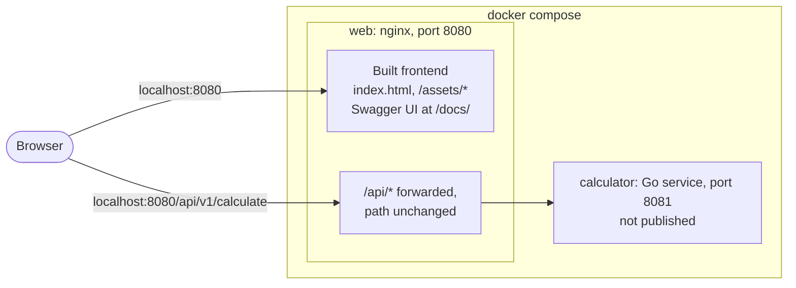
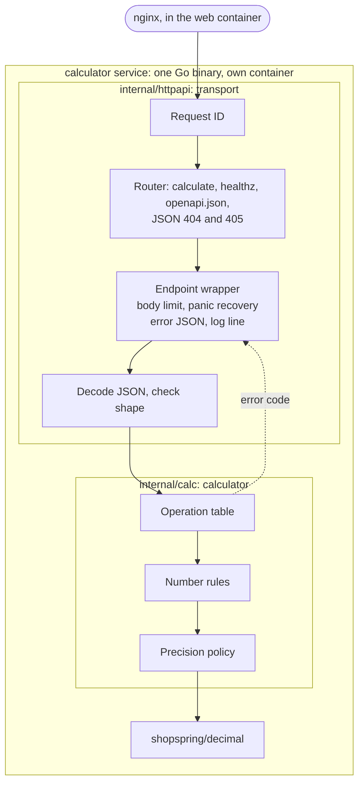
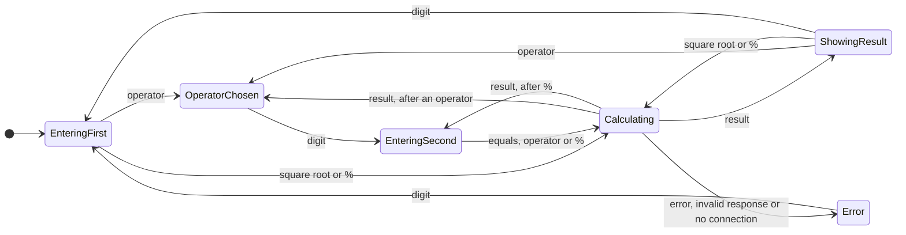

# Design and testing details

The long version of the [README](../README.md): how the API description is kept honest, the architecture, every design decision, and what the tests check.

## API documentation

With the stack running, open <http://localhost:8080/docs/> for Swagger UI. Every operation has examples, including errors such as division by zero and a JSON-number operand, and "Try it out" sends them to the running service.

The API is described by a hand-written OpenAPI 3.1 document, [`backend/internal/httpapi/openapi.json`](../backend/internal/httpapi/openapi.json). It is embedded in the binary and served by the service itself, so any OpenAPI tool can read it:

```sh
curl -s http://localhost:8080/api/v1/openapi.json
```

It describes the request and response schemas, every error status with the codes it can carry, the `X-Request-ID` header, and examples for every operation and for most errors. It also lists `503 SERVICE_UNAVAILABLE`, marked as sent only by nginx. Its `servers` entry is `/`, so "Try it out" calls the origin that served the document.

In development, the Vite dev server forwards `/api`, so the document is also at <http://localhost:5173/api/v1/openapi.json>, and with `go run` alone at <http://localhost:8081/api/v1/openapi.json>. The Swagger UI page itself is built into the web container only, so view it with `docker compose up -d --build`; editing `openapi.json` needs a rebuild of the `calculator` image, as it is embedded in the binary.

Swagger UI is self-hosted, not loaded from a CDN, so the page keeps the app's rule that scripts come from this origin only. The Dockerfile copies its stylesheet, script, icon and licence files from the pinned `swagger-ui-dist` package into `/docs/`, next to `frontend/api-docs/index.html` and `init.js`, which starts it. The script is a file rather than inline code, so the page needs no `'unsafe-inline'`. The only CSP difference on `/docs/` is `img-src 'self' data:`: `swagger-ui.css` draws its icons (the select arrow, the copy button, the expand chevrons, the checkboxes) as `data:` SVG images, which the app's `img-src 'self'` blocks. The page was checked in headless Chrome: it renders, "Try it out" returns the real `200`, `422` and `400` responses, and no CSP violation is reported.

It is JSON, not YAML, because the standard library reads JSON and the backend has no other dependency to add for it. It is written by hand rather than generated, because generating it from Go would need a library or annotations; instead, the contract tests in `backend/internal/httpapi/openapi_test.go` fail when it and the code disagree:

- the `operation` enum is not exactly calc's operation table, or an operation has no success example;
- a code in the `statuses` table is missing or listed under another status, or the document lists a code the service does not have (only nginx's `SERVICE_UNAVAILABLE`, under 503, is allowed);
- an error response does not use the error schema for its status, or one of its examples has a code that status does not carry;
- the number pattern, the operand length limit or the request ID pattern differs from the code;
- a path or method in the document is not a registered route, or a registered route is not in the document;
- an example is not what the service sends. Each request example is sent to the real handler and must get the response example of the same name: the same status, content type and JSON body, message included. The response examples that no request produces (a body over 4 KiB, the 404, the 405 and the 500) are produced by a test as well. Only nginx's 503 cannot be produced in the Go tests.

The examples sit at the limits, such as a 35-digit operand and an exponent of 1001, so changing a limit without the document fails a test. What the tests do not check: the schemas themselves (a response with an extra or renamed field would still pass if its examples were updated too), and the prose in the descriptions. Both are kept by hand.

The document was also checked once with Redocly CLI 2.77.0 (`redocly lint`, recommended rules), which is not part of the repo: no errors. The warnings left are deliberate: five values in request examples that break the schema on purpose to show an error (a JSON-number operand, `1e5`, an unknown key, an unknown operation), the shared 404 and 405 responses, which belong to no single operation, no 4XX response on the two `GET` operations, and no license. With the default settings, `no-invalid-media-type-examples` also flags the `message` of all 17 error examples, because it checks each part of an error schema's `allOf` on its own against unknown properties; with its `allowAdditionalProperties: true` option those warnings go away and the five deliberate ones remain.

## Architecture

Docker Compose runs two containers:



- **`web`** (`frontend/Dockerfile`, `frontend/nginx.conf`) runs nginx. It serves the built React app and forwards every `/api/*` request to the calculator with its path unchanged. It is the only container with a published port. It starts once the calculator reports healthy.
- **`calculator`** (`backend/Dockerfile`) is the Go service. It is reachable only from inside the Compose network.

Inside the calculator service:



The service is one Go binary with two packages, and depends only on the standard library and shopspring/decimal.

- **`internal/httpapi`** is the transport. It routes, decodes JSON, checks the request's shape, maps error codes to statuses and writes the logs. Handlers return their error instead of writing it, so one wrapper produces every error response and log line. The package never imports the decimal library, and a test checks that.
- **`internal/calc`** is the calculator. It looks the operation up in a table, checks the operands against the number rules, runs the operation and applies the precision policy. It is pure: no I/O, no logging and no state.


## Design Decisions

### Decimal precision

The arithmetic uses [shopspring/decimal](https://github.com/shopspring/decimal), because its values are immutable. Its own rounding doesn't fit, though: `Div` rounds to 16 decimal places, so `0.000000000000000001 ÷ 3` comes back as `0`. So `internal/calc` owns all rounding:

- Every result keeps 34 significant digits (the IEEE 754 decimal128 precision), rounded half to even.
- Each result is rounded exactly once. Add, subtract, multiply and percentage are exact, and their result is rounded afterwards. Division truncates with `QuoRem`, and the exact remainder decides the last digit. Square root and power are described below.
- `calc` may use only an allowlist of 21 shopspring functions and methods, plus its `Decimal` type, and `Bit` and the integer `Sqrt` from `math/big`. That keeps out the ones that round or format on their own terms, such as `Div`, `Sqrt`, `Pow`, `Avg` and the `UseScientificNotation` setting. A test enforces it.

[cockroachdb/apd](https://github.com/cockroachdb/apd) offers this rounding control directly, but writes results into mutable pointers. With shopspring, the precision rules are our own roughly 100 lines of code. They are tested against Python's `decimal` module, and the fuzz tests compare every add, subtract, multiply, divide, percentage and power result with an exact `math/big` calculation that is rounded separately. Integer minor units, the usual choice for money, don't fit either: a calculator has no currency and no fixed scale.

### Square root and power

shopspring's `Sqrt` and `Pow` round to a fixed number of decimal places, like `Div`, so both have their own path in `precision.go`. Each keeps something exact to round from, so there is still only one rounding step.

- **Square root:** the operand is scaled by an even power of ten to a whole number N with 67 or 68 digits. Go's `big.Int.Sqrt` gives q = ⌊√N⌋ exactly, which is the root truncated to 34 digits. The exact remainder N − q² decides the last digit: round up when it is greater than q. A square root can never land exactly halfway, so there is no tie to break. `exact` is `true` only when the remainder is zero.
- **Power:** the base is raised to the exponent exactly, by repeated squaring. With at most 34 significant digits in the base and an exponent of at most 1000, the exact power has at most 34 000 digits, which takes under 2 ms even for the largest inputs. A positive power is then rounded once. A negative power is 1 divided by the exact power, through the same division as `divide`. A result outside the range is `OUT_OF_RANGE`, checked after rounding like every other operation.

### String-based numerical representation

In binary floating point, `0.1 + 0.2` is `0.30000000000000004`. Doing decimal arithmetic in Go isn't enough on its own, because JSON numbers get turned back into floats by `JSON.parse` in the browser, and by Go if a field is a `float64`. So numbers are strings everywhere:

- The API rejects JSON numbers.
- The frontend does no arithmetic. In the app's source (not its tests), ESLint bans the `Number`, `parseFloat`, `parseInt`, `Math` and `BigInt` globals and any member with those names (such as `globalThis.Number`), unary `+`, the operators `-`, `*`, `/`, `%` and `**` with their compound assignments, and `++` and `--`. Binary `+` is allowed because it also joins strings. Its number checks read the string itself.
- A test fails if `calc` uses a float type.

Every result follows the same rules as an operand, so a result can always be sent back. The accepted and rejected formats are listed once in `testdata/numbers.json`, and both the Go tests and the frontend's number schema tests run against it.

### Stateless backend

The brief asks for a backend microservice, so there is exactly one, and it stores nothing. Any instance can be stopped or replaced at any time.

On SIGTERM, the server stops accepting connections and lets in-flight requests finish within 5 seconds, which is under Docker's 10-second stop grace period. The Dockerfile uses an exec-form `ENTRYPOINT`, so the Go process is PID 1 and receives the signal itself. The runtime image is distroless and has no shell or `curl`, so the health check runs `calculator -healthcheck`.

### Validation and error handling

`httpapi` checks only the shape of a request. It reads the whole body before parsing, so any body over 4 KiB is `INPUT_TOO_LARGE` wherever its first syntax error is, and it parses with `encoding/json/v2`, which rejects duplicate keys and anything after the object. `calc` checks everything about the numbers, and an operation's operand count is part of its row in the operation table, so adding an operation touches one place. The frontend's `numberError` (`frontend/src/validation/number.ts`) applies the same number rules in the same order as `parseOperand` in `number.go`, so each rejection has the code the backend would send, and it runs against `testdata/numbers.json` too. Its Zod schema, used on API results, is defined by it. It is there to stop the user typing an invalid number; the backend never relies on it.

One table maps each error code to its HTTP status. A test type-checks `calc` and fails if any constant of type `Code` is missing from the table. Errors caused by the request are logged at info level with their code, because a user dividing by zero is the service working correctly. Only a 500 is logged at error level, together with its cause.

### Serving through nginx

The browser talks to one origin, `localhost:8080`. nginx serves the built app there and forwards `/api/*` to the calculator, so the client calls a relative URL and the service needs no CORS headers and no published port. The Vite dev server does the same forwarding in development, so the client code is identical in both.

nginx here is a static file server and a reverse proxy, not an API gateway. It does no authentication, rate limiting, request rewriting or routing between services; the service validates every request itself. A gateway with API keys and rate limits is part of the [production design](production-design.md), not built.

- **Errors in one format.** The errors nginx makes for API calls use the service's error JSON, with `Content-Type: application/json`: its 502 (no address for the service, or a refused connection), 504 (no connection or no answer in time) and 503 all become `503 SERVICE_UNAVAILABLE`, and its 413 becomes `INPUT_TOO_LARGE`. `/api` without a slash gets the JSON `NOT_FOUND` instead of nginx's redirect to `/api/`. nginx does not intercept the service's own responses, so the service's 400, 404, 405, 413, 422 and 500 bodies pass through untouched. Malformed HTTP that nginx rejects before routing, such as an oversized header (400) or URI (414), still gets nginx's default HTML page.
- **Body limit.** The service's 4 KiB limit is the one that applies. nginx's limit is 16 KiB, a backstop that stops a large body before it is forwarded. A 10 KB body therefore gets the service's `INPUT_TOO_LARGE`, and a 20 KB body gets nginx's.
- **Finding the service.** nginx looks the calculator's address up through Docker's DNS at run time (every 5 seconds) instead of once at start, so it starts before the calculator is resolvable and finds a restarted container with a new address. After a restart, requests succeed again within about 5 seconds.
- **Request IDs.** nginx forwards a well-formed incoming `X-Request-ID` (the same pattern the service accepts), or makes one of 32 hex characters, and logs it. The service keeps it, so one ID ties the two log lines together. nginx hides the service's copy of the header and adds its own to every response, including static files and its own errors, so there is always exactly one.
- **Caching and compression.** Files under `/assets/` have content hashes in their names, so they are cached for a year (`immutable`). `index.html` is `no-cache`, so a new build is picked up on the next load. A missing asset is a 404, never `index.html`; every other path falls back to `index.html` for the single-page app. Only the build is served, not the base image's sample pages. JavaScript, CSS, JSON, SVG and HTML over 1 KB are sent gzip-compressed.
- **Security headers.** `X-Content-Type-Options: nosniff`, `Referrer-Policy: no-referrer`, `X-Frame-Options: DENY` and a Content Security Policy: scripts, styles, images and API calls from this origin only, with nothing inline, and fonts from Google Fonts (`fonts.googleapis.com` for the stylesheet, `fonts.gstatic.com` for the files). The API documentation under `/docs/` also allows `data:` images, which Swagger UI's stylesheet uses for its icons; the policy is still one `add_header`, with `img-src` picked by path. Base UI's scroll area would add a small inline `<style>` element to hide its native scrollbar, so `main.tsx` turns that off with Base UI's `CSPProvider` (`disableStyleElements`), and `index.css` has the same two rules. `server_tokens off` hides the nginx version.
- **Build context.** The image is built from the repository root, not `frontend/`, because `npm run build` type-checks the tests too, and one of them imports `testdata/numbers.json`. Building with `vite build` alone would skip the type check, so the image could be built from code that fails it. `frontend/Dockerfile.dockerignore`, which BuildKit applies to that Dockerfile only, is an allowlist: only `frontend/` (without `node_modules`, `dist`, `coverage` and `.env*` files) and that one JSON file are sent.
- **Container.** The runtime image is `nginxinc/nginx-unprivileged`: it runs as a non-root user on port 8080. The container is read-only with a tmpfs on `/tmp` for nginx's pid and temp files, drops every capability and sets `no-new-privileges`, like the calculator's. nginx is started directly in exec form as PID 1, skipping the base image's entrypoint scripts, which adjust the config at start; without them, the config that runs is exactly `nginx.conf`. It stops on `SIGQUIT`, nginx's graceful shutdown, which finishes in-flight requests. Its proxy timeouts (2 seconds to connect, 5 to answer) keep any request it is waiting on within the 10-second stop grace period.
- **Port binding.** Port 8080 is published on `127.0.0.1` only. The app is for the person running it, so nothing is exposed to the local network; change the mapping to `"8080:8080"` to open it.
- **Settings in one `.env`.** The values that change from machine to machine live in one file at the repository root: copy the committed `.env.example` to a git-ignored `.env`. `WEB_PORT` is the published port, read by Compose, and `API_PROXY_TARGET` is where the dev server forwards `/api`, read by `vite.config.ts` with `loadEnv`; a shell variable wins. It is `.env` rather than a JSON or YAML file because every reader already understands it: Compose reads it natively, Vite with one call, and the Go service gets its settings as environment variables, so nothing needs a parser. There are no secrets. The browser's API address is deliberately not a setting: Vite would copy it into the public bundle at build time, and another origin would be blocked by the CSP's `connect-src 'self'` and by the service, which sends no CORS headers. The calculator's own port stays fixed in `docker-compose.yml` and `nginx.conf`, because it is never published and so never clashes with anything on the host. The root `.env` is outside both Docker build contexts, so it never reaches an image.

### Frontend state management

The calculator's state is a `useReducer` with a pure reducer (`frontend/src/calculator/reducer.ts`), tested without rendering. There is one screen and nothing shared between components, so there is no Redux.

`frontend/src` has one folder per kind of code, and each test sits next to the file it tests:

```text
api/          the API client and the Zod schemas for its answers
validation/   the number rules, shared with the backend through testdata/numbers.json
calculator/   the reducer, the display model, error messages and the key table
hooks/        useCalculator (state plus the request in flight) and useKeyboard
components/   the calculator's parts and the docs panel
  ui/         small reusable pieces: CopyButton, ValueText, icons
test/         the test setup
```



- **The shown number.** Each number on the display is a `Shown` value: either typed, or a result from the backend with its `exact` flag. One function, `applyEntryKey`, applies the digit, decimal point and sign keys to it.
  - On a typed number, the keys edit it and keep you in the current entry state. A key that would make an invalid operand, such as a second decimal point, a 35th significant digit or a 257th character, is ignored. The check is `numberError`, and a number ending in `.` is allowed only if a digit could still follow it. The sign key on `0` gives `-0`, so a negative number can be typed sign first.
  - On a result, a digit or the decimal point starts a new typed number from `0`. The sign key negates the result by toggling its minus sign and keeps its `exact` flag. A zero result has no sign and stays as it is.
  - After an operator or an error, the keys start a new typed number from `0`, so `.` gives `0.` and the sign key gives `-0`.
- **Clear** returns to `EnteringFirst` from any state, dropping any keys that were waiting.
- **Typing ahead.** In `Calculating`, every other key waits in the state's `pending` list. When the answer arrives, they are applied in order, so `2 + 3 × 4 =` gives `20` however fast it is typed; a key that starts another request waits for that one in turn. If the request fails, they are dropped and the error stays on the display.
- **Chaining.** When an operator started the request, the result becomes the first number with that operator chosen, so `2 + 3 × 4 =` sends `add(2, 3)` and then `multiply(5, 4)`. A second operator key in a row replaces the first.
- **The `%` key.** After `a + b`, `%` sends `percentage(b, a)` and the result replaces `b`, so `50 + 10 % =` gives `55`. Like any result, it is replaced by the next digit: `50 + 10 % 3 =` sends `add(50, 3)`. With no operator chosen, `x %` sends `percentage(x, 1)`, which is x ÷ 100. Right after an operator, `%` is ignored.
- **Rounded results.** A result keeps its `exact` flag wherever it goes: `ShowingResult`, the first number after an operator, or the second number after `%`. So the display can mark it.
- **What was calculated.** `ShowingResult` and `Error` keep the calculation they answer (its request and where its result went), so the display can show `1 ÷ 3 =` above the result. The sign key on a result builds a new `ShowingResult` without it, because the calculation no longer describes the number.

The reducer does no arithmetic and no fetching. Entering `Calculating` is the request: the state holds the request to send, where its result goes (`ShowingResult`, `OperatorChosen` with the next operator, or back into the second number), and the number that was on the display, as it was sent (a typed `5.` is `5`). `useCalculator` runs one effect per request object, sends it, and dispatches `settled` with that request and its outcome. The reducer settles only when it is the same request object it is waiting for, so a late answer to a cleared request is ignored. Leaving `Calculating` (Clear) or unmounting also aborts the fetch through its `AbortController`. The hook returns `{ state, press }`; `press` takes keypad keys only, never `settled`.

### Frontend API client

`frontend/src/api/client.ts` calls `POST /api/v1/calculate` with native `fetch` and a relative URL, because nginx serves the page and the API from one origin. In development, Vite forwards `/api` to the backend on port 8081. Zod checks every response, and a result must itself be a valid operand. `calculate()` never throws; it returns one of:

- `success`, with `result` and `exact`
- `error`, with the API's error code and its message. The code is `null` when this client doesn't know it, for example a code added to a newer backend; the message is still shown.
- `invalidResponse`: a JSON answer that breaks the API's contract, such as a 200 whose result is a JSON number or not a valid operand, an error body with a 200 status, a success body with an error status, or an error without a message
- `unreachable`: no response, or a body that is not JSON, such as a proxy's HTML error page. An aborted request also ends here, and the reducer ignores it.

### Frontend interface

The calculator is one column, at most 420 px wide: a header, the display card, and the keypad. The column is the viewport's height up to 680 px (where the keys reach 60 px), so the `=` key is always on screen: the keys shrink from 60 px to 44 px on short phones, and on screens under 600 px tall the padding and gaps go from 16 px to 12 px. Checked with no page scroll at 320 × 568, 375 × 553 (iPhone SE in Safari), 375 × 667 and 390 × 844, and without sideways scrolling at 320 px wide. The visual design ("Ledger") is specified in [docs/frontend-design.md](frontend-design.md); its colours are Tailwind theme tokens in `frontend/src/index.css`, and the type is IBM Plex Mono and Plex Sans from Google Fonts. There is no dark theme.

- **Docs panel.** A short guide (`components/Docs.tsx`): how it works and why it is built this way, in plain English, and links to Swagger UI, `openapi.json` and the repo, which open in a new tab. From 1024 px wide it is a column of at most 68 characters on the left, and the calculator is pinned on the right while it scrolls. Below that, the calculator fills the first screen as before and the guide follows; an "About" link in the calculator's header jumps to it. The calculator comes first in the DOM, so it is first for screen readers and `Tab`. `Enter` on a focused link follows the link and does not press equals. The guide is JSX, so there is no Markdown dependency.
- **Keypad.** Twenty-one real buttons, 44 px to 60 px tall, with an `aria-label` on each symbol key (`Clear`, `Square root`, `Power` and so on). Pressing a key with a mouse or finger does not move focus to it, so `Enter` on the keyboard still means equals.
- **Keyboard.** Digits, `.`, `+ - * /`, `^`, `%`, `Enter` and `=` (equals), `Escape` and `Delete` (clear). There is no Backspace, because the reducer has no action that deletes one character. The listener is on `window`, and it leaves alone keys typed into a field, shortcuts with Ctrl, Cmd or Alt (AltGr still types), and `Enter` on a focused button.
- **Display.** The expression line shows what is being calculated (`50 +`, `1 ÷ 3 =`, `√2 =`, `50 + 10%`), on one line: a long one is cut at its start with an ellipsis, so the operator or `=` stays in view, and the full text is its `title`. The value is in a live region (`role="status"`, `aria-live="polite"`), which also says ", rounded to 34 significant digits" for a rounded result. The font steps down from 40 px to 26 px until the value fits, measured rather than estimated, and is fitted again when the web font has loaded. A value still too long scrolls horizontally inside Base UI's `ScrollArea`, which fades whichever edge hides digits: a result shows its leading digits, and a number being typed shows its last ones. A result with `exact: false` gets the "≈ Rounded to 34 digits" chip. A shown result has a Copy button, which falls back to selecting the value when the clipboard is unavailable.
- **Calculating.** The card has `aria-busy`, and the previous value dims while "Calculating…" shows in the footer. Both wait 300 ms, so a fast answer does not flicker. Keys stay enabled and wait for the answer, except Clear, which cancels the request.
- **Errors.** Each error code has its own short message, and no code is ever shown. A code the client does not know shows the backend's message. No answer, or nginx's `SERVICE_UNAVAILABLE`, shows "Can't reach the calculator." with a no-connection icon. An answer that breaks the API's contract shows "Something went wrong." The next digit starts a new number.

What the components show comes from pure, tested functions: `displayModel` (`calculator/display.ts`) turns the reducer's state into the expression and the value, and `failureText` (`calculator/messages.ts`) picks the error text. `calculator/keys.ts` is one table of the keys, with each key's label, accessible name and the keyboard keys that press it; the keypad renders it, and `keyAction` is built from it.

### Frontend dependencies

Versions are pinned exactly in `frontend/package.json`, with a committed lockfile.

| Package | Why |
| ------- | --- |
| `react`, `react-dom` | The UI library the brief asks for. |
| `zod` | Validates typed input and API responses with one schema per shape, instead of hand-written type guards. |
| `@base-ui/react` | Unstyled, accessible components. The display uses its `ScrollArea` for a long value: the viewport is focusable only when it scrolls, and it marks which edges hide content, so the fade is shown only where digits are hidden. The keys are plain buttons, which need nothing more. |
| `vite`, `@vitejs/plugin-react` | Dev server with the `/api` proxy, and the production build. |
| `typescript` | Strict type checking. Version 6.0, because `typescript-eslint` does not support TypeScript 7 yet. |
| `tailwindcss`, `@tailwindcss/vite` | Styling with utility classes, built by the Vite plugin with no separate config file. |
| `vitest`, `@vitest/coverage-v8` | Test runner that shares Vite's config, and its coverage report. |
| `jsdom` | A browser environment for tests that render or use React hooks. |
| `@testing-library/react`, `@testing-library/dom` | Renders components and hooks in tests; the second is the first's required peer. |
| `@testing-library/user-event` | Simulates a real click and Tab in tests, including the focus change a mouse press causes, which `fireEvent` does not. |
| `eslint`, `@eslint/js`, `typescript-eslint`, `eslint-plugin-react-hooks` | Linting, type-aware for TypeScript, with the rules of hooks and the ban on arithmetic. |
| `@types/react`, `@types/react-dom`, `@types/node` | Type definitions for React, and for Node in `vite.config.ts`. |
| `swagger-ui-dist` | Swagger UI for the API documentation at `/docs/`, served from this origin instead of a CDN, so the CSP still allows scripts from this origin only and the version is pinned here. It is a dev dependency because the app never imports it: the Dockerfile copies its built files into `/docs/`. It depends on `@scarf/scarf`, which sends install analytics from an npm install script; `"scarfSettings": {"enabled": false}` in `package.json` turns that off. |

## What the tests check

The commands and the coverage numbers are in the [README](../README.md#testing-and-coverage).

- **`internal/calc`:** expected results come from Python's `decimal` module, an independent implementation of the same rounding rules. For power, Python computes the exact power and rounds it once. `backend/internal/calc/testdata/reference.py` (standard library only) recomputes every row of the two result tables; run `python3 testdata/reference.py` in `backend/internal/calc`, and it exits non-zero if any expected value, `exact` flag or error code differs. The cases include half-even ties, results that round past 10¹⁰⁰ or land exactly on 10⁻¹⁰⁰, exponents of ±1000 and 1001, `2.5`, `-0` and `1.0`, and square roots of exact squares, tiny and huge numbers and zero. A fuzz test checks that any add, subtract, multiply, divide or percentage gives either a named error or a valid operand, that every result and its `exact` flag match an exact `math/big` calculation rounded separately, and that exact results of the first four survive the inverse operation. Two more fuzz tests cover power and square root. Every power, its `exact` flag and every refusal must match the same `math/big` reference, which raises numerator and denominator separately. An exact power of −1 taken again gives the base back, and the square root of an exact square gives the base's absolute value. An exact root squared gives the operand back, and a rounded root r is within half a unit in its last place, checked exactly by squaring r minus and plus that half unit. One test runs the shared number cases. Another type-checks the package and fails on any of these:
  - a value of float type
  - a function or method from another package outside the allowlist, which keeps out shopspring's self-rounding calls and anything that changes a value in place
  - an import that could do I/O, read the clock or log
  - a package-level variable other than the operation table and the number pattern
  - a direct write to a package-level variable: an assignment, `++` or `--`, `delete`, `clear`, or taking its address (a write through a copied map reference is not caught)

  That check is itself tested against a sample that breaks each rule.
- **`internal/httpapi`:** every status and error code is tested, including the exact 4 KiB body limit, duplicate keys, oversized bodies that are not JSON, paths not in clean form, and a 405 on every route. Each error must produce exactly one info-level log line carrying the request ID the client received. Panics and unmapped codes must become a 500 whose log line keeps the original error. One test fails if a `calc` error code, found by type-checking the package, has no HTTP status. Another fails if the package imports the decimal library. The OpenAPI contract tests are described under [API documentation](#api-documentation).
- **`cmd/calculator`:** a request still in flight when shutdown starts must complete, and the `-healthcheck` flag is tested.

The frontend:

- **`validation/number.ts`:** every case in `testdata/numbers.json` must be accepted, or rejected by `numberError` with the code the file gives. Length is measured in UTF-8 bytes, as Go does.
- **`api/client.ts`:** `fetch` is mocked. Tests cover the request sent, success, a known error, an error code it does not know (kept as an error with its message), each kind of contract-breaking answer, a body that is not JSON, and a network failure.
- **`calculator/reducer.ts`:** one test per arrow in the state diagram, plus Clear from every state, keys typed ahead in `Calculating` (applied after an answer, dropped after a failure), an answer to an old or different request ignored, each `%` case, the entry keys on typed numbers and on results, and the entry limits.
- **`hooks/useCalculator.ts`:** `fetch` is mocked. Tests check that one request is sent per calculation, that Clear and unmount abort it, and that the answer to a cleared request cannot settle the next one.
- **`calculator/display.ts`, `calculator/messages.ts`, `calculator/keys.ts`:** the expression and value for every state, the text for every error code, and the keyboard map and which keys are left to other inputs.
- **Components:** rendered with React Testing Library, with `fetch` mocked. Key presses and keyboard input send the right requests and show the results; a mouse press leaves focus where it was, so `Enter` then means equals, while a key reached with Tab is pressed by `Enter`; after unmount, keys send nothing; the rounded chip appears only when `exact` is false; every error code shows its text and never the code; an unknown code shows the backend's message; the unreachable and invalid-response states; Copy writes the full value to the clipboard, and selects it when the clipboard fails; Clear while calculating aborts the request and ignores its late answer. jsdom does no layout, so the font-size tests give elements the widths a browser would, including a refit when the web font loads.

### CI

`.github/workflows/ci.yml` runs on every push to `main` and every pull request:

- **backend:** `go vet`, then `go test -race` with coverage, uploaded as the `backend-coverage` artifact (`coverage.out` and an HTML report).
- **frontend:** lint, typecheck, Vitest with coverage (uploaded as `frontend-coverage`), and the production build.
- **smoke:** builds and starts the full stack with Compose and runs `scripts/smoke.sh`: the page, one calculation and one backend error through nginx, then the JSON `503 SERVICE_UNAVAILABLE` with the calculator stopped. The same script runs locally after `docker compose up -d --build --wait`.
