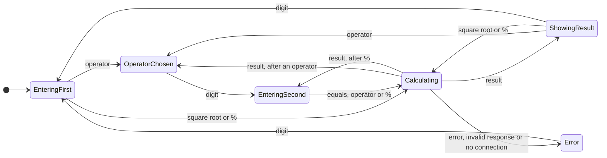

# Frontend design

**Status: the logic core is built; the UI is not.** The number checks, the API client and the state machine below are built and tested in `frontend/src` (see the README). The keypad, display and layout are not built yet. The backend it talks to is built.

## Behaviour

- A keypad that also works from the keyboard. It runs one operation at a time, left to right, like a pocket calculator: `2 + 3 × 4` gives `20`, and each result becomes the first number of the next operation.
- The backend computes every result. The browser does no arithmetic.
- A result with `exact: false` is marked as rounded.
- Error text is chosen from the error `code`. There is a separate message when the service cannot be reached.
- The `%` key works like a pocket calculator's:
  - After `50 + 10`, `%` sends `percentage(10, 50)`, which is 10% of 50. The result `5` replaces the second number and the `+` stays, so a following `=` gives `55`.
  - With no operator chosen, `10 %` sends `percentage(10, 1)`, which is 10 ÷ 100 = `0.1`.
  - Right after an operator, before a second number is typed, `%` is ignored.
- A long result (up to 34 significant digits, or up to 100 digits before the decimal point) shrinks the display text down to a minimum size, then scrolls horizontally. A copy button copies the full value.

## State



- Digits, the decimal point and the sign key keep you in the current entry state.
- On a result, a digit or the decimal point starts a new number, and the sign key negates the result and keeps its rounded marker.
- Clear returns to `EnteringFirst` from any state, and cancels a request in flight.
- In `Calculating`, every other key is ignored. When the request was started by an operator rather than `=`, the result becomes the first number with that operator already chosen.

The state lives in the calculator component as a `useReducer` with a pure reducer, tested without rendering. There is one screen and nothing shared between components, so there is no Redux.

## Stack

- React, TypeScript and Vite.
- Base UI components styled with Tailwind CSS.
- Zod validates user input and API responses. The input rules are tested against `testdata/numbers.json`, the same cases the Go tests use.
- Native `fetch`. Tests use Vitest and React Testing Library.

## Serving with nginx

The web container runs nginx, which serves the React build and forwards `/api/*` to the calculator. The page and the API then share one origin, so there is no CORS setup and the calculator needs no public port. nginx is not an API gateway: it does no authentication or rate limiting.

nginx's own errors use the service's JSON format: its 502, 503 and 504 responses become `SERVICE_UNAVAILABLE` (503), and its 413 becomes `INPUT_TOO_LARGE`. A CI smoke test will stop the calculator and expect the JSON 503.

## Visual design: "Ledger"

Chosen from three drafts on the [design canvas](https://claude.ai/artifact/AfAyYn18vXyhqiTYR4SGSz) (version A, plus its display-states sheet). The direction is a precise instrument: calm, exact, monospaced digits, and one clear marker when a result was rounded.

**Type.** IBM Plex Mono (400, 500) for every number, the expression line and the keys. IBM Plex Sans (400, 500, 600) for labels, messages and buttons. Loaded from Google Fonts with `display=swap`, falling back to `ui-monospace` and `system-ui`.

**Colours.** Every text colour passes 4.5:1 on the surface it sits on.

| Token | Value | Use |
| --- | --- | --- |
| `ground` | `#F6F5F1` | Page background |
| `surface` | `#FFFFFF` | Display card, digit keys |
| `ink` | `#16181D` | Main text, digits |
| `muted` | `#5B606B` | Expression line, captions |
| `dimmed` | `#6B717C` | The previous value while calculating |
| `hairline` | `#E2E0D9` | Borders of the card and digit keys |
| `function-key` | `#ECEAE4`, border `#DDDAD2` | `C`, `√`, `xʸ`, `%` |
| `accent` | `#1F4FD1` | Operator symbols, `=` key background, focus ring |
| `operator-key` | `#E8EEFC`, border `#D3DDF7` | `÷ × − +` |
| `rounded` | text `#7A4F00` on `#FFF4DA` | The "≈ Rounded to 34 digits" chip |
| `error` | `#B42318`, card border `#F1C9C4` | Service error messages |

**Layout (phone first).** One column with 16 px padding and 16 px gaps: a header row ("Calculator", and "Exact decimals" as a caption), then the display card, which takes the remaining height, then the keypad. On wider screens the same column is centred, at most 420 px wide. There is no separate desktop layout.

**Display card.** White, 14 px radius, 20 px padding, contents aligned to the bottom:
- Expression line: right-aligned, 17 px mono, `muted`, such as `50 +` or `1 ÷ 3 =`.
- Value: 40 px mono, right-aligned. A long value shrinks step by step to 26 px. If it still doesn't fit, it scrolls horizontally from its leading digits, with a 40 px fade on the right edge. The full value is always in the DOM, and `output` has `aria-live="polite"`.
- Footer row, 44 px tall: on the left the rounded chip when `exact` is false (nothing when exact); on the right a "Copy" button (icon and label) when a result is shown.

**Keypad.** A 4-column grid with 8 px gaps and 60 px keys with a 10 px radius, all real `<button>`s. Icon-like keys have an `aria-label` (`Clear`, `Square root`, `Power`, `Percent`, `Divide`, `Multiply`, `Subtract`, `Add`, `Change sign`, `Decimal point`, `Equals`).

```
C   √   xʸ  %
7   8   9   ÷
4   5   6   ×
1   2   3   −
±   0   .   +
=  (spans all four columns)
```

The keyboard maps digits, `.`, `+ - * /`, `^`, `%`, `Enter` and `=` (equals), and `Escape` or `Delete` (clear). There is no Backspace: the reducer has no action that deletes one character, and Clear covers mistakes on a calculator this simple. The focus ring is 2 px in `accent`, offset 2 px.

**States** (from the states sheet):
- Calculating: the previous value in `dimmed`, three dots and "Calculating…" in the footer, `aria-busy` on the card. Keys stay enabled but are ignored (the reducer's rule), except `C`.
- Error: an icon and the message in `error` in place of the value, and "Type a number to start again." in the footer. The text is chosen by error code. For a code the client doesn't know, the backend's message is shown.
- Unreachable: a no-connection icon, "Can't reach the calculator.", and "Check your connection, then try again." There is no retry button, because the reducer leaves Error only on a digit or Clear.

## Open questions

None.
