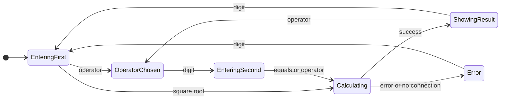

# Frontend design

**Status: planned, not built.** The backend it talks to is built.

## Behaviour

- A keypad that also works from the keyboard. It runs one operation at a time, left to right, like a pocket calculator: `2 + 3 × 4` gives `20`, and each result becomes the first number of the next operation.
- The backend computes every result. The browser does no arithmetic.
- A result with `exact: false` is marked as rounded.
- Error text is chosen from the error `code`. There is a separate message when the service cannot be reached.

## State

- Digits, the decimal point and the sign key keep you in the current entry state.
- Clear returns to `EnteringFirst` from any state, and cancels a request in flight.
- In `Calculating`, every other key is ignored. When the request was started by an operator rather than `=`, the result becomes the first number with that operator already chosen.

The state lives in the calculator component as a `useReducer` with a pure reducer, tested without rendering. There is one screen and nothing shared between components, so there is no Redux.

## Stack

- React, TypeScript and Vite.
- Base UI components styled with Tailwind CSS.
- Zod validates user input and API responses. The input rules are tested against `testdata/numbers.json`, the same cases the Go tests use.
- Native `fetch`. Tests use Vitest and React Testing Library.

## Serving with nginx

The web container runs nginx, which serves the React build and forwards `/api/*` to the calculator. The page and the API then share one origin, so there is no CORS setup and the calculator needs no public port. nginx is not an API gateway: it does no authentication or rate limiting.

nginx's own errors use the service's JSON format: its 502, 503 and 504 responses become `SERVICE_UNAVAILABLE` (503), and its 413 becomes `INPUT_TOO_LARGE`. A CI smoke test will stop the calculator and expect the JSON 503.

## Open questions

- Visual design and layout.
- How the keypad's `%` key maps onto the planned `percentage` operation.
- How the display fits a long result: up to 34 significant digits, or up to 100 digits before the decimal point.
