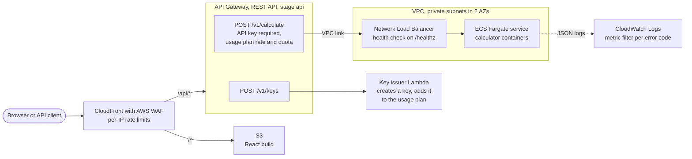

# Production design

**Status: design only, not built.** The local build has no API gateway, authentication or rate limiting. This page describes how the calculator would run on AWS with them. The calculator's container image would run unchanged.

| Local build                         | AWS design                                                  |
| ----------------------------------- | ----------------------------------------------------------- |
| nginx serving the React build       | S3 behind CloudFront                                        |
| nginx forwarding `/api/*`           | A CloudFront behaviour forwarding `/api/*` to API Gateway   |
| No gateway, auth or rate limits     | WAF per-IP limits, plus API keys with usage plans           |
| The calculator container            | The same image on ECS Fargate, two or more tasks across AZs |
| Compose health check on `/healthz`  | NLB target health check on `/healthz`                       |
| `docker stop`: SIGTERM, 10 s grace  | ECS task stop: SIGTERM, 30 s default stop timeout           |
| JSON logs on stdout                 | CloudWatch Logs, with a metric filter per error code        |

- **API keys identify a client** so API Gateway can throttle and meter it. They don't authenticate anyone, and AWS's documentation advises against using them for that. Real user sign-in would be a Cognito user pool authorizer.
- **Key creation needs its own per-IP limit.** Anyone can create a key, so without the WAF rule a client that hits its limit would simply create a new one.
- **Errors keep the service's JSON format.** API Gateway's default error bodies (`{"message": "Forbidden"}`) are replaced through its gateway responses: throttling and quota errors become `RATE_LIMITED` (429), a missing or unknown key becomes `INVALID_API_KEY` (403), and integration failures become `SERVICE_UNAVAILABLE` (503). The WAF block response uses the same `RATE_LIMITED` body.
- **Fargate rather than Lambda,** because the same image runs locally and in production, and the graceful shutdown and health check carry over unchanged. Lambda would need an adapter and would add cold starts.
